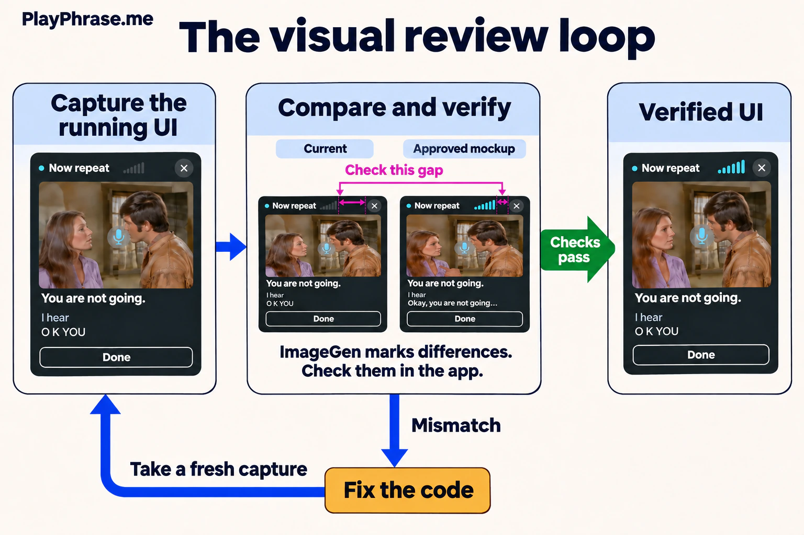
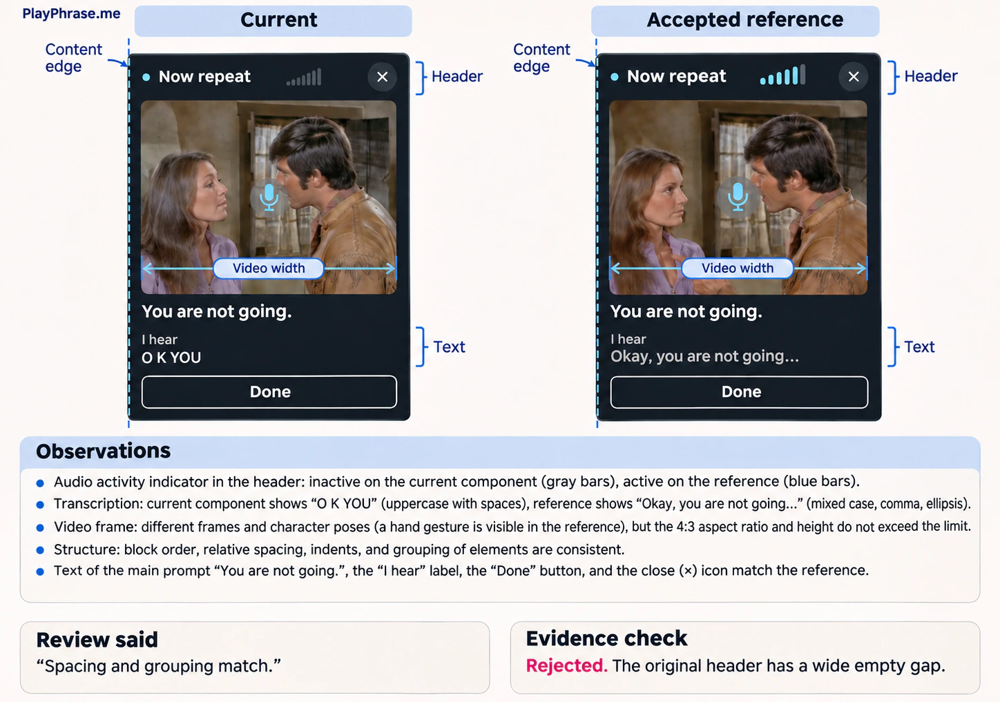
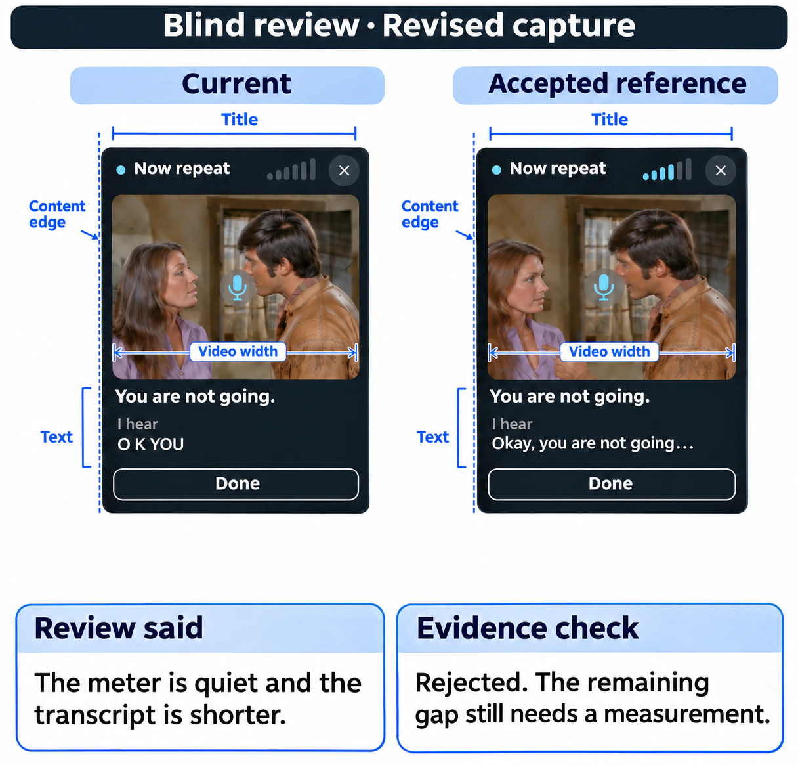
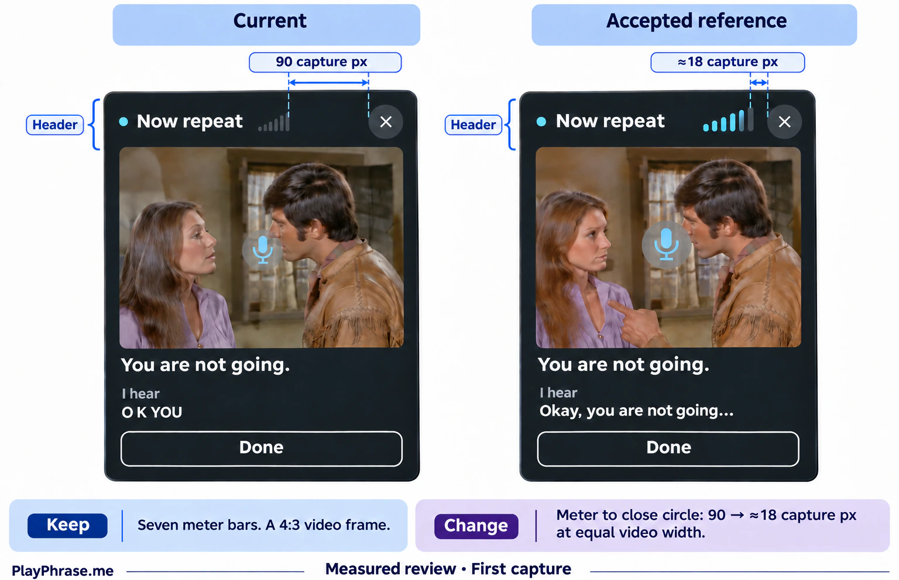
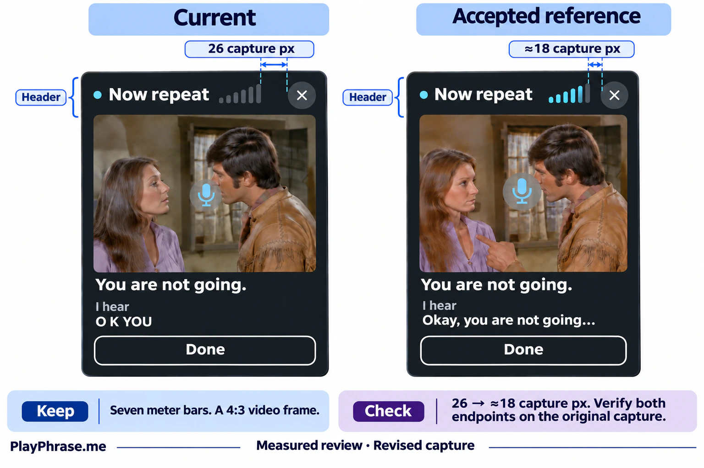
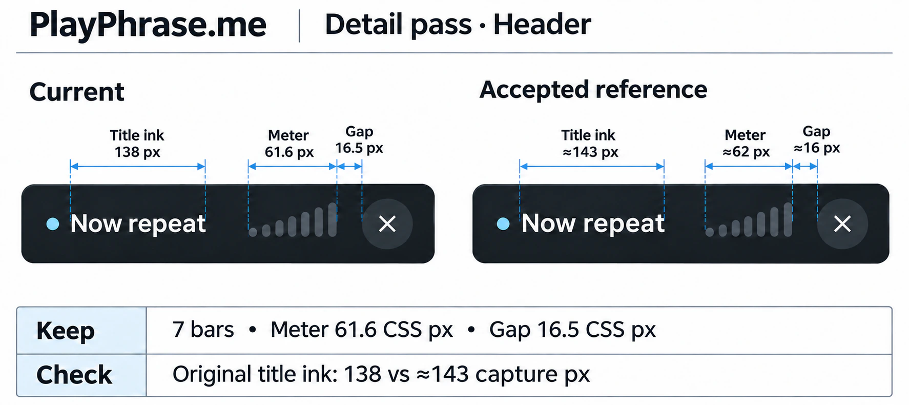
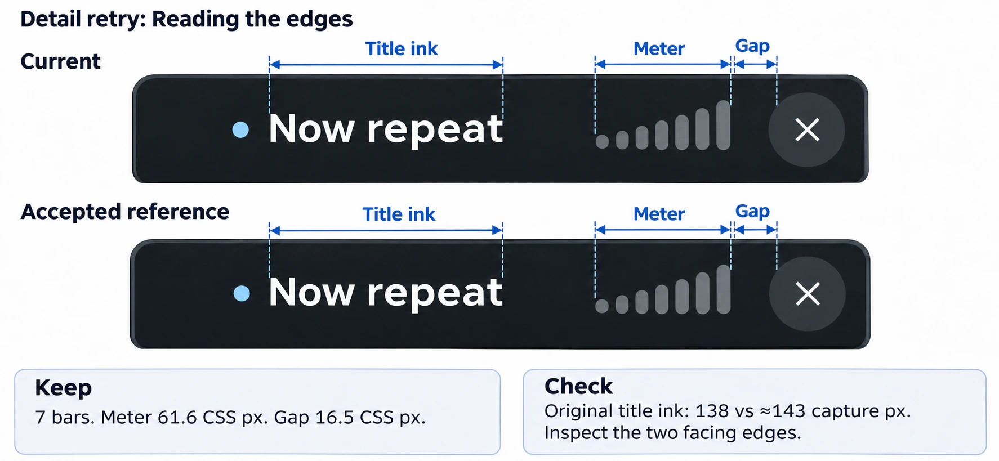
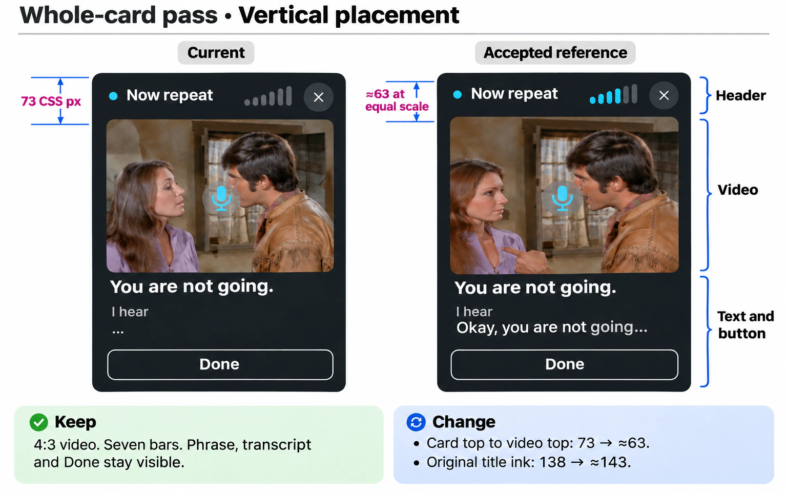
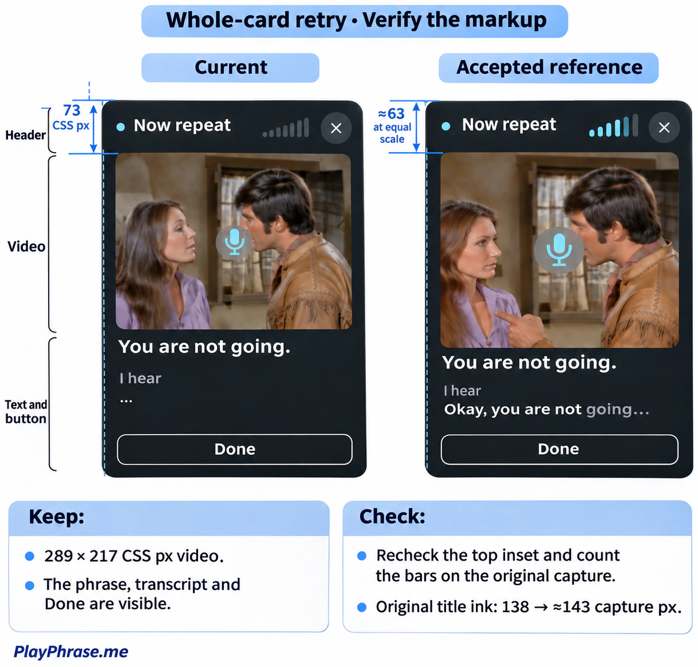
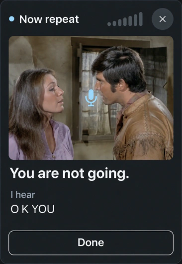

# ImageGen UI Redesign

A coding agent can change a layout, open the app and post a screenshot that still shows the bug. This skill gives the agent a way to check its own work against the mockup you approved. [Use with Codex](#try-it-in-codex) · [Use with Claude Code](#use-with-claude-code) · [Make it the default for UI work](#make-it-the-default-for-ui-work).

> *ImageGen* is shorthand for OpenAI’s image generation and editing tools. Codex offers [ChatGPT Images 2.5](https://openai.com/index/introducing-chatgpt-images-2-5/). The Claude Code integration uses `gpt-image-2` via the API.



Codex gives ImageGen the approved mockup, a capture of the running component and any measurements it already has. ImageGen illustrates the comparison and can flag other differences. The developer and the agent see the same proposed correction on the sheet. In the player below, an arrow marks the empty space between the last volume bar and Close so the agent knows which two edges to measure.

If the measurement confirms a mismatch, the agent fixes the code, captures the affected parts and compares the whole component again with the **same mockup**. That fresh capture shows whether the fix worked and whether it moved a neighboring control. The review stays open while a required state is missing or a material difference remains.

**For precise layout reviews on a supported Mac, we recommend pairing this skill with [UI Blueprint](https://github.com/potapenko/ui-blueprint).** Its CLI and companion skill let the agent measure gaps, sizes and alignment in the running UI, then repeat the same measurement after a fix. [Install UI Blueprint for Codex or Claude Code](https://github.com/potapenko/ui-blueprint#install-through-your-agent).

## How a gap survived two visual reviews

We built this while working on the PlayPhrase.me pronunciation player. A learner watches a clip and repeats the line. During recording, seven bars beside the title show the input level. In the approved design, the bars and the round Close button form a compact group. In our browser, Close looked stranded at the far end of the header.

We gave ImageGen the recording card and the approved mockup and asked it to find any material difference. Its review said the spacing and grouping matched. Look at the empty space just before the ×.

*The eight figures below are English editions of the review sheets. The text describes what happened in the original tests, including drawing errors corrected in the English illustrations.*



We ran the same prompt on a revised capture, again without mentioning Close. This time the review picked up the quieter meter and shorter transcript. Both change naturally during recording. It still missed the gap.



## Give the comparison two edges

We put the original images at the same video width and measured from **the right edge of the last bar to the left edge of the painted circle**. On the first capture, that space occupied **90 pixels**. On the approved mockup, it occupied **about 18**. With those endpoints named, ImageGen could draw a useful comparison.



The revised capture measured **26 pixels** across the same interval. The fix had removed most of the empty space. The historical redrawing put one arrow inside the meter, though, so we checked the remaining difference against the originals. That is why the skill keeps the source capture alongside every generated sheet.



## Review the header on its own

For the next check, we captured a later desktop build and cropped the complete header from both views. Keeping it intact let us ask three separate questions. How wide was the visible title? Did all seven bars fit in the expected span? How much space was left before Close?

At a video width of 289.2 CSS px, the browser measured **61.6 CSS px** for the meter and **16.5 CSS px** for the gap. The corresponding estimates from the reference were about 62 and 16 at that scale. Both relationships held. The original Russian title lettering was still about five pixels narrower.



In the original run, the first drawing counted the status dot as part of the title and lost a meter bar. We asked for another drawing with guides on the first and last letters. It restored the seven bars, but its gap arrow still missed the edge of the circle. We kept the browser measurement in the review.



## Put the header back in the card

The detail crop settled the question about Close. It could tell us nothing about where the movie started below it. We sent the **whole card** and the same approved design back to ImageGen. The video had the agreed 4:3 shape, and the phrase, transcript and Done button were visible. But the top of the video sat **73 CSS px** below the top of the card. The design suggested about **63** at the same video width.



We asked for a final sheet with both guides anchored to those top edges. The guides improved, but the redrawn reference lost a bar again. We closed the meter and Close checks using the running UI. The title width and video position remained open in this desktop comparison.



## What the team got back

In the final docked run, all seven bars were visible, the video filled its 4:3 frame, and Close sat beside the meter. The browser measured the gap at **18.3 CSS px**, against about **18** in the reference scaled for the docked column. The two findings in the desktop comparison above are recorded separately.



*English illustration based on the [original localhost capture](illustrations/runtime-docked-recording-final.png). The measurements come from the running card.* [Docked header measurements](illustrations/prompts/10-header-relationships.md) · [Final check across five player states](illustrations/prompts/18-final-whole-card.md).

This is the handoff we ask for on our team: the running component, its approved reference, and a short account of what matched and what still needs work. After a repair, Codex checks the affected part and its neighbors, then compares the whole component again. The last step matters whenever a change inside one part can move another.

## Try it in Codex

Paste this prompt into Codex:

```text
$skill-installer Install imagegen-ui-redesign from https://github.com/potapenko/imagegen-ui-redesign
SKILL.md is at the repository root. Use --path . and --name imagegen-ui-redesign.
Resolve the repository's default branch and pass it as --ref.
After installing the redesign skill, follow its "Choose the geometry source"
instructions. Use an available, compatible UI Blueprint installation. If it
is missing, ask me whether to install it or use browser/native measurements.
```

The workflow is tested in Codex with ImageGen and access to a running UI. For web work, use a browser that can open your development site. For SwiftUI, use the app or a simulator that can capture the native screen. This case was recorded on the web. [About agent skills](https://learn.chatgpt.com/docs/build-skills).

Attach your approved mockup and adapt this prompt to your component:

```text
Use $imagegen-ui-redesign to match the recording card at <local URL> to the
attached mockup. Check the listening and recording states on desktop and mobile.
Review the header, video, transcript and action button. Fix confirmed layout
differences. After each fix, recheck the affected parts and the whole card.
Show the final running UI and tell me which differences are still open.
```

For a review without edits, ask Codex to report the differences. For a new design, give it the current screen and describe the change. It shows you a mockup for approval before implementing new visual choices.

To reproduce this story, download the [original inputs](docs/examples/source-inputs.zip) and run the [eight English test prompts](docs/examples/prompts.md). The [full player casebook](illustrations/README.md) also covers video framing, the Repeat button and scrolling in the short floating window.

## Use with Claude Code

Paste this installation prompt into **local Claude Code**. The install step needs no OpenAI key
and makes no image requests. [Claude Code skills](https://code.claude.com/docs/en/skills).

```text
Install the imagegen-ui-redesign skill from https://github.com/potapenko/imagegen-ui-redesign.git
in my personal skills directory at ~/.claude/skills/imagegen-ui-redesign.
The repository root contains SKILL.md. Clone it into that directory, keeping
the helper and reference files together. Preserve any existing installation.
Check that Node.js is version 22 or newer and run node imagegen.mjs --help
from the installed directory. Tell me how to invoke /imagegen-ui-redesign.
Then follow its "Choose the geometry source" instructions. Use an available,
compatible UI Blueprint installation. If it is missing, ask me whether to
install it or use browser/native measurements.
```

**Image generation is billed separately by OpenAI.** The helper sends the
prompt and attached screenshots directly to the OpenAI Images API using
`gpt-image-2`. Each generated or revised sheet uses your OpenAI API project.
A part review, whole-card review and retry are separate calls. Use a project
with API billing and image model access. The OpenAI charges are separate from
your Claude plan. [Create an OpenAI API key](https://platform.openai.com/api-keys) · [Image pricing](https://developers.openai.com/api/docs/pricing#image-generation).

Set `OPENAI_API_KEY` in the environment that starts Claude Code. The installer
never needs its value or a project ID. Keep the key out of chat, Git and
command history. In Bash or Zsh, run the following line on its own. Paste
the key at the hidden terminal input, then press Enter.

```sh
read -rs OPENAI_API_KEY
```

In the same terminal, export the variable, check it locally and start Claude:

```sh
export OPENAI_API_KEY
node "$HOME/.claude/skills/imagegen-ui-redesign/imagegen.mjs" --check
claude
```

The check only confirms that the variable is set. The first actual image
request verifies access and can incur a charge. Open your project, attach
the approved mockup, and try:

```text
/imagegen-ui-redesign Compare the running card at <local URL> with the attached
mockup. Use my OpenAI Images API key from the environment for the review sheets.
Check the header details and then the whole card. Show me each sheet inline,
or open it in my local image viewer if this terminal cannot display it.
```

Claude Code needs access to the running site or native app to take fresh captures.
Use the same browser or simulator workflow you normally use in that project.
We verified skill discovery in Claude Code 2.1.318 and tested both image request
formats with offline responses. A paid end-to-end image call in Claude Code has
yet to be verified.

## Optional geometry measurements with UI Blueprint

To add geometry measurements, pick the **Codex** or **Claude Code** install prompt in
the [UI Blueprint installation guide](https://github.com/potapenko/ui-blueprint#install-through-your-agent).
It installs the CLI and its matching skill together. During a review, the agent
can then tell you which two edges it measured, how far apart they are and in
which units. For example, the distance to the visible Close circle can differ
from the distance to the edge of its clickable area.

If the tool is missing, the agent offers a choice:

- **Install UI Blueprint.** The agent explains the supported install method
  and destination, waits for your approval, then follows the
  [official setup for Codex or Claude Code](https://github.com/potapenko/ui-blueprint#install-through-your-agent)
  and checks that the matching CLI and skill work together. Where a source
  build is needed, that is part of the choice.
- **Continue without Blueprint.** The agent measures with the project's
  browser or native tools and records which source it used. Say “Skip UI
  Blueprint for this project” for a project-wide choice, or “Skip it for
  this review” for just this run. The agent carries that choice across fixes.

The redesign skill can be installed on its own. If a platform or a required
frame is unsupported, the agent explains the gap before switching methods.
If you want a choice to survive new chats, ask the agent to add it to your
project or personal instructions.

## Make it the default for UI work

Install the skill first. To use it without naming it in every UI request,
copy the block below into the instructions your agent reads.

| Where you want the rule | Codex | Claude Code |
| --- | --- | --- |
| One project | `AGENTS.md` in the repository root | `CLAUDE.md` in the repository root |
| All your projects on this machine | `~/.codex/AGENTS.md` by default | `~/.claude/CLAUDE.md` by default |

If both tools already read the same project instructions, add the rule there
once. A project `CLAUDE.md` can import a neighboring `AGENTS.md` with
`@AGENTS.md`. [Codex instruction files](https://learn.chatgpt.com/docs/agent-configuration/agents-md) · [Claude Code instruction files](https://code.claude.com/docs/en/memory).

**Copy this rule into your instructions file:**

```markdown
## UI design review

Use the installed `imagegen-ui-redesign` skill whenever a task creates a Web or
SwiftUI design, substantially changes a layout, or checks UI against an approved
mockup. Read its SKILL.md before starting, even if the request omits the skill name.

Get approval for new visual choices. For an approved design, compare the running
UI to that same reference with ImageGen. Check composite components by part and
then as a whole. Verify findings against the original captures or runtime measurements.
Follow the skill's UI Blueprint setup choice for geometry and honor any scoped opt-out.
After every fix, recheck the affected parts and neighbors, take a fresh capture of
the whole component, and send it to ImageGen with the same reference.

Show the review sheets and the final running UI. Keep the review open while a
required state is unverified or a material difference remains. A standalone,
fully specified minor edit outside a mockup review only needs a focused check.
```

**Or ask your agent to add it.** Paste this prompt from the project you want to
configure. For a personal default, change the first line to `Scope: all my projects.`

```text
Scope: this project.
Make imagegen-ui-redesign the default for UI design and mockup reviews.
Copy the “UI design review” block from the installed skill's README. The current
version is also at https://github.com/potapenko/imagegen-ui-redesign#make-it-the-default-for-ui-work
Use the active AGENTS.md for Codex or CLAUDE.md for Claude Code at the selected
scope. Create the file if needed. If a shared file at that scope already owns
the rule, update it there. Merge any equivalent rule once, preserve unrelated
instructions, and show me the file path and diff.
```

To check the setup, start a new chat in that project and ask: “Which skill would
you use to match a running card to my mockup? What would you check again after
moving its Close button? Describe the procedure only.”
