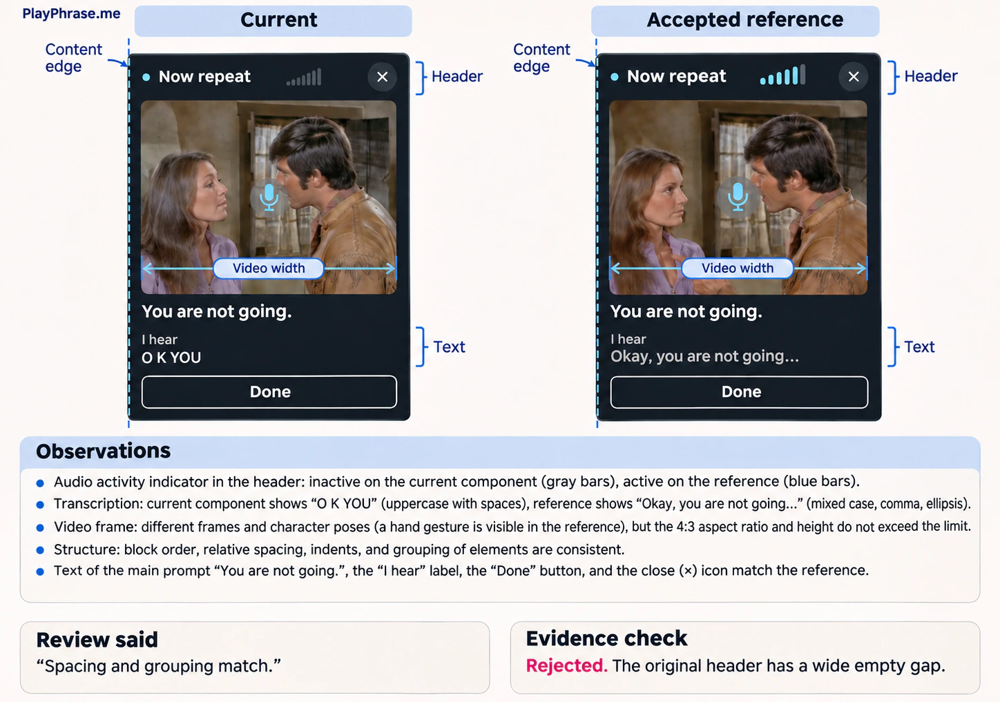
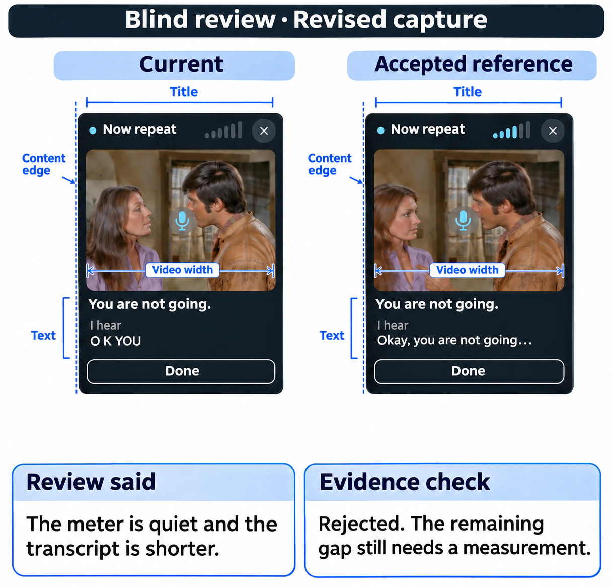
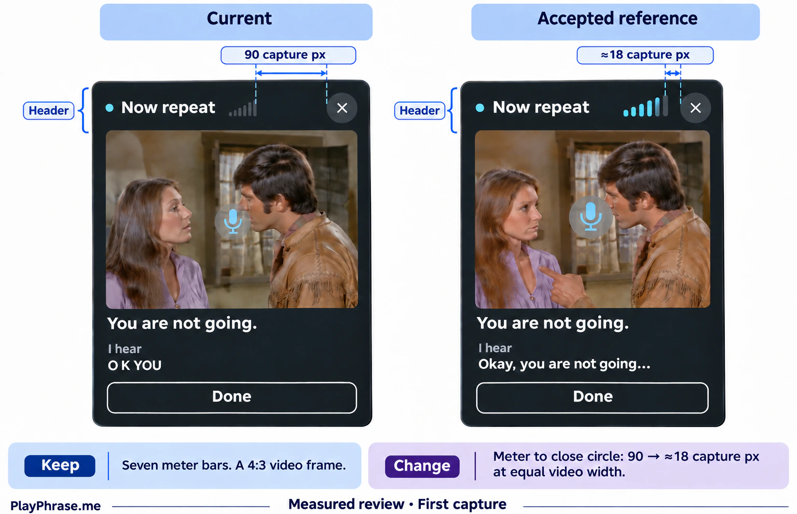
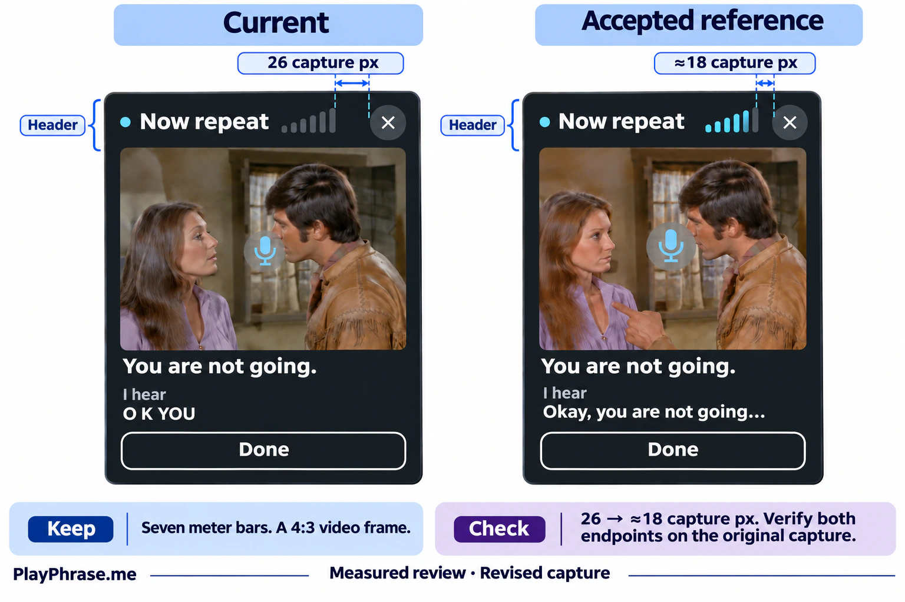
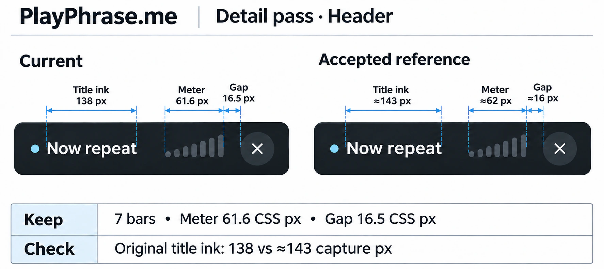
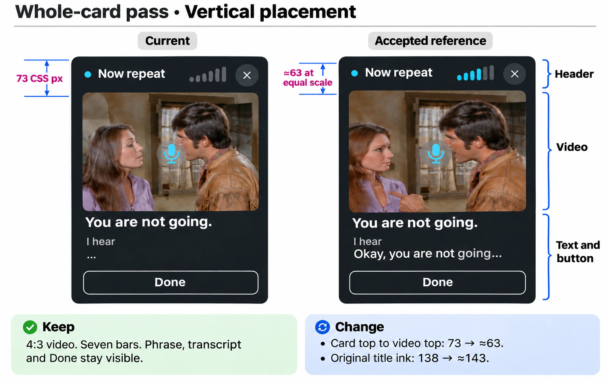
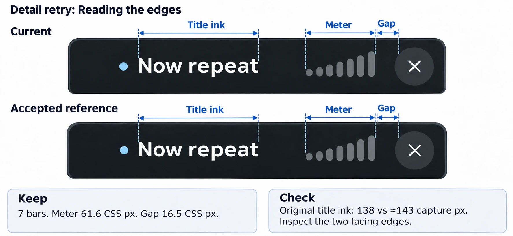
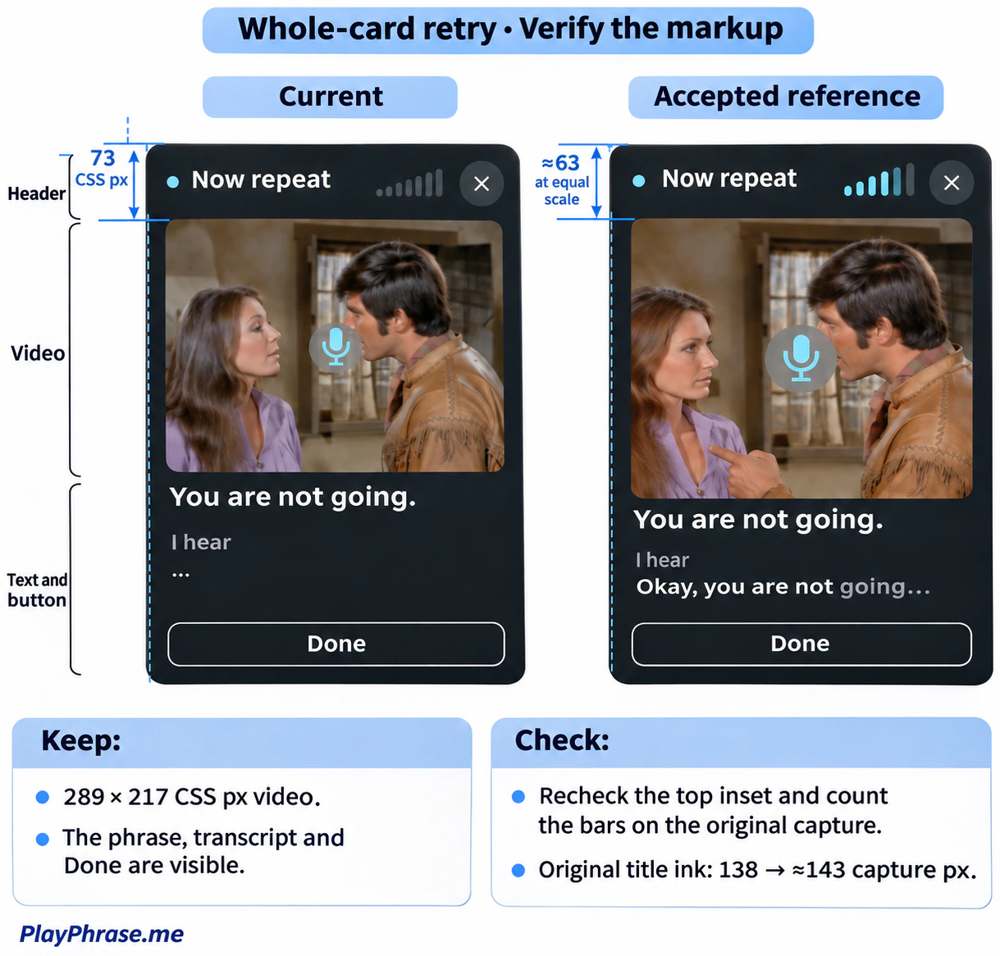

# PlayPhrase.me visual review gallery

A pronunciation card can have the right video shape and seven volume bars
while the close button still looks detached. These eight English illustrations
follow two reviews of that card. The measurements come from the original
browser captures and accepted design sheets.

**For the skill README:** [the first measured comparison](03-measured-before.webp)
shows the most visible defect. Pair [the header detail](06-header-retry.webp)
with [the whole-card comparison](07-whole-first.webp) to show both levels of review.
This Markdown is ready to paste into the repository's main README.

```markdown


[Explore the part-by-part review and try the eight prompts](docs/examples/README.md)
```

[English test prompts](prompts.md) · [Original test inputs (ZIP)](source-inputs.zip)

## The space before Close

The first two calls ask the same open question about the whole card. The next
two repeat the comparison with a measurement from the original images. All
gap values in this sequence are **capture pixels at equal video width**.

| First capture | Revised capture |
| --- | --- |
| **01 · Blind review** | **02 · Same prompt, new capture** |
|  |  |
| The original review reported matching spacing and missed a 90 px gap. **Rejected.** | The review described live audio and transcript differences. It missed the remaining 26 px gap. **Rejected.** |
| **03 · Check the original edges** | **04 · Check the correction** |
|  |  |
| The last bar and the painted close circle were about 18 px apart in the scaled reference. The implementation left 90 px. | The gap fell to 26 px. The original generated arrow started inside the meter, so the measurement was checked on the source capture. |

## The header first, then the whole card

A later desktop capture used a video width of **289.2 CSS px**. The browser
reported 61.6 CSS px for the meter and 16.5 CSS px for the gap. The reference
was scaled to that video width. Its corresponding estimates were about 62 and
16. The earlier 90/26/≈18 values belong to a different capture scale.

| Detail review | Whole-card review |
| --- | --- |
| **05 · Title, meter and gap** | **07 · Video placement** |
|  |  |
| The meter count and span matched. The original title ink occupied 138 px against a reference estimate of 143. The first generated sheet accidentally included the leading dot in the title span. | The 4:3 frame and reading order held. The video started 73 px below the top of the card against about 63 in the reference. The detail crop alone could not show that difference. |
| **06 · Correct the dimension lines** | **08 · Check the drawing against the source** |
|  |  |
| The original retry restored seven bars and excluded the leading dot. Its gap arrow still missed the painted circle edge. The browser measurement supplied the result. | The original retry attached the vertical guides to the right boundaries, but the redrawn reference had six bars. The full card retained two open findings: title width and video position. |

All gallery images are localized ImageGen illustrations. The outcome captions
describe the historical tests. The ZIP retains the unedited, original-language
input images so the measurements and prompts can be checked against the same
evidence. In particular, 138 and ≈143 describe the original title glyphs, not
the width of the translated phrase “Now repeat”.
