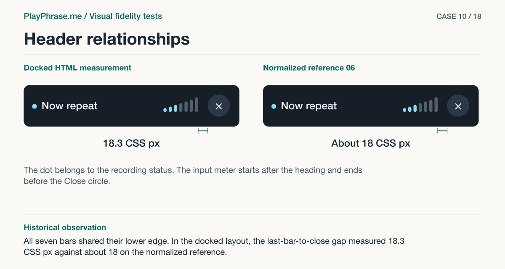
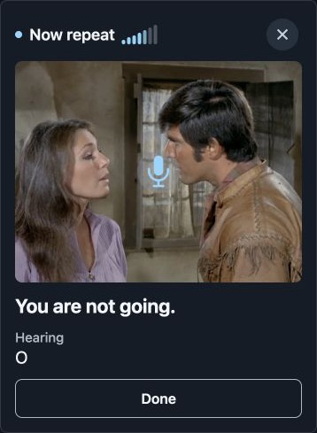
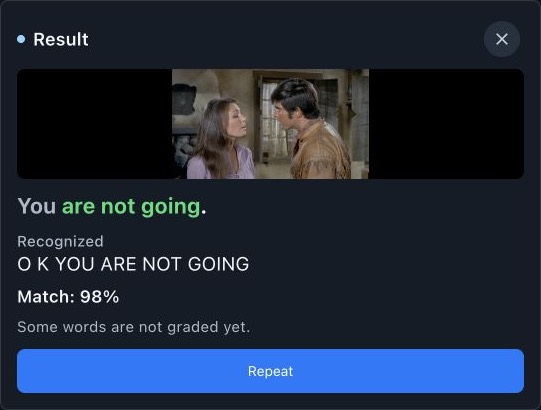
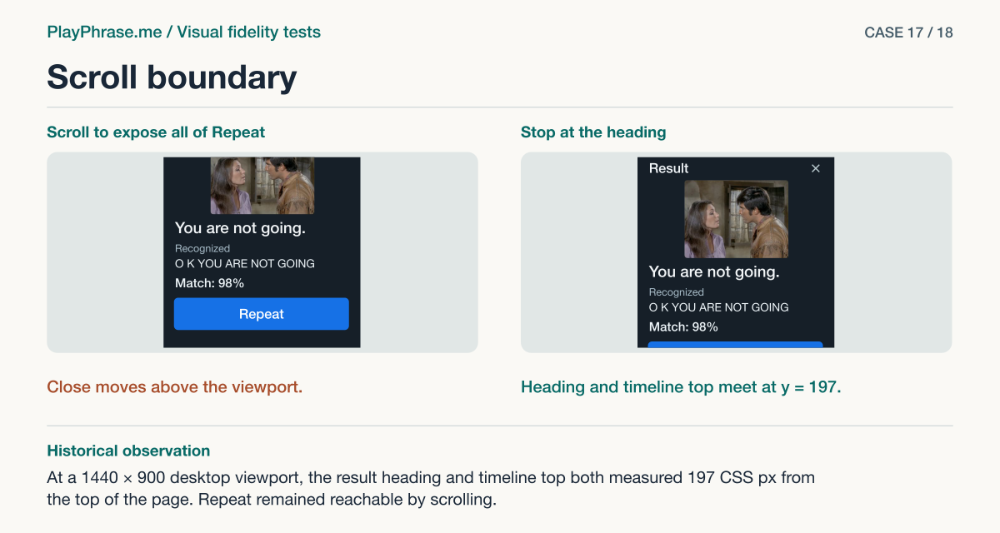
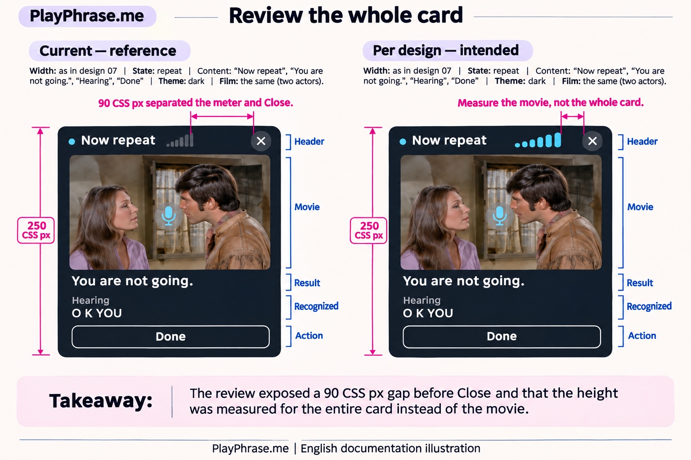

# Visual fidelity tests for the PlayPhrase.me pronunciation widget

The original bug report showed two recording cards. One displayed the input meter. On the other, all seven bars had disappeared. A count checked whether the bars existed. Comparing the entire header revealed a second defect. The final bar sat 90 CSS px from Close.

This case study follows the widget from a playing film through recording, transcription and the result of one attempt. It includes the full English editions of the 18 ImageGen requests that produced review sheets, including rejected experiments. Each prompt includes a checked English diagram, an English ImageGen redraw, and a short account of the historical outcome. Browse the [English ImageGen gallery](imagegen/README.md) for the illustrations and their review notes. The [eight-test comparison series](../docs/examples/README.md) follows a separate review of the same widget.

## The review loop

1. **Match the inputs.** Capture the running component and keep its containing screen. Pair it with the accepted reference for the same state, locale, theme and available width.
2. **Compare the parts.** Crop each part from both inputs. Keep both edges of a gap and enough of their common parent to see the relationship. Measure the DOM or original images and record which measurement comes from which source.
3. **Compare the whole card.** Send the complete component and the same accepted reference to ImageGen. Ask for material differences anywhere in the card, including ones the prompt did not name. Check the proposed findings against the original images.
4. **Repair and repeat.** After an implementation change, revisit the affected part and its neighbors. Capture and compare the whole component again across the affected states and layouts.

For a short walkthrough, read [the header comparison](prompts/10-header-relationships.md), [the whole-card action audit](prompts/14-whole-card-action.md), [the revised action detail](prompts/15-revised-action-detail.md) and [the final whole-card check](prompts/18-final-whole-card.md). The chronological index below also includes the early attempts that led to this workflow.

In the docked column, the final gap between the last capsule and Close measured **18.3 CSS px**. Reference 06, normalized to the same film width, gave approximately **18 CSS px**. The status dot sits before the title and is counted separately.

## Original English capture

**Localhost capture.** In-app browser, 390 × 844 CSS px responsive viewport, *Rio Lobo*, controlled Daniel speech. This crop shows the early recording state and a partial hypothesis of “O.” It predates the final header revision.

## Why the full window matters

The operator chose a centered **4:3** film area. A wider source fills its height and crops equally on the left and right. An earlier framing experiment used a 507 × 110 CSS px area and introduced black side bands. That experiment is preserved as a rejected case in [test 03](prompts/03-video-framing.md).

**Localhost capture.** In-app browser, 1280 × 900 CSS px desktop viewport, floating chat, *Rio Lobo*, controlled Daniel speech. This is the rejected implementation from the framing experiment.

Even a correct card crop can hide a scroll problem. In the short floating window, scrolling the Repeat button fully into view could push the result heading and Close above the conversation. The repair limited automatic movement at the header. On the 1440 × 900 desktop viewport, the heading and conversation both began at y = 197 CSS px. The remaining portion of Repeat was reachable by scrolling.

## Using the prompts

Open an example, attach the files listed in order, and copy the fenced prompt. The [input inventory](INPUTS.md) lists filenames and hashes for the separately distributed replay archive. You can also substitute your own paired runtime captures and accepted mockups. Replace all case-specific measurements when you do.

**Language and provenance.** The original requests mixed English instructions with Russian labels and annotations. These editions translate the output directions, captions and UI labels into English while preserving the historical measurements and requested comparisons. Some original measurements used Russian text. Re-measure English glyphs before using those numbers as English layout targets. The 18 numbered figures are English teaching diagrams. Their labels and geometry describe the recorded comparisons. The two images labeled “Localhost capture” are unaltered English screenshots from the original run. An optional companion archive preserves all 18 historical ImageGen sheets alongside their English generated adaptations. Some adaptations repeat or introduce drawing errors, documented in its index. The quoted transcripts, grades and word colors in the historical prompts belong to individual attempts.

**Runtime coverage.** The short example used “You are not going.” and a controlled microphone input that added “Okay.” The widget returned “O K YOU ARE NOT GOING.” The long example used an 18-word line from *The Shawshank Redemption*. The test voice replaced “good” and “sisters” with “bad” and “brothers.” One attempt returned 89% with both original words marked red. Desktop checks exercised the docked column and the floating window. Mobile checks used responsive viewports in the in-app browser. The simulator Safari session reached the sign-in screen.

## One generated sheet under review

This English ImageGen redraw illustrates a failure in test 04. The left arrow labeled “250 CSS px” spans the height of the card, although the measurement belongs to the video. The 90 CSS px gap was a real finding. Check each pair of endpoints before quoting the label.

## Prompt index

| No. | English test prompt and illustration | Historical outcome |
| --- | --- | --- |
| 01 | [Button outline](prompts/01-button-outline.md) | Rejected |
| 02 | [Meter count retry](prompts/02-meter-count-retry.md) | Rejected |
| 03 | [The side-band mistake](prompts/03-video-framing.md) | Rejected by the operator |
| 04 | [Whole-card composition](prompts/04-composition.md) | Partial |
| 05 | [Recording-state recheck](prompts/05-recording-recheck.md) | Rejected |
| 06 | [Result hierarchy](prompts/06-result-hierarchy.md) | Partial |
| 07 | [Header detail](prompts/07-header-detail.md) | Useful finding |
| 08 | [Desktop placements](prompts/08-desktop-placements.md) | Partial |
| 09 | [Mobile layouts](prompts/09-mobile-layouts.md) | Partial |
| 10 | [Header relationships](prompts/10-header-relationships.md) | Verified in HTML |
| 11 | [Film and microphone](prompts/11-film-and-microphone.md) | Partial |
| 12 | [Live text and Done](prompts/12-live-text-and-done.md) | Verified in HTML |
| 13 | [Result and Repeat](prompts/13-result-and-repeat.md) | Useful finding |
| 14 | [Whole-card action audit](prompts/14-whole-card-action.md) | Useful finding |
| 15 | [Revised action detail](prompts/15-revised-action-detail.md) | Verified in HTML |
| 16 | [Whole-card recheck after the action fix](prompts/16-post-action-whole-card.md) | Context check required |
| 17 | [Scroll boundary](prompts/17-scroll-boundary.md) | Verified in HTML |
| 18 | [Final whole-card verification](prompts/18-final-whole-card.md) | Final comparison |

[Two input-limit attempts](prompts/preflight.md) are documented separately.
