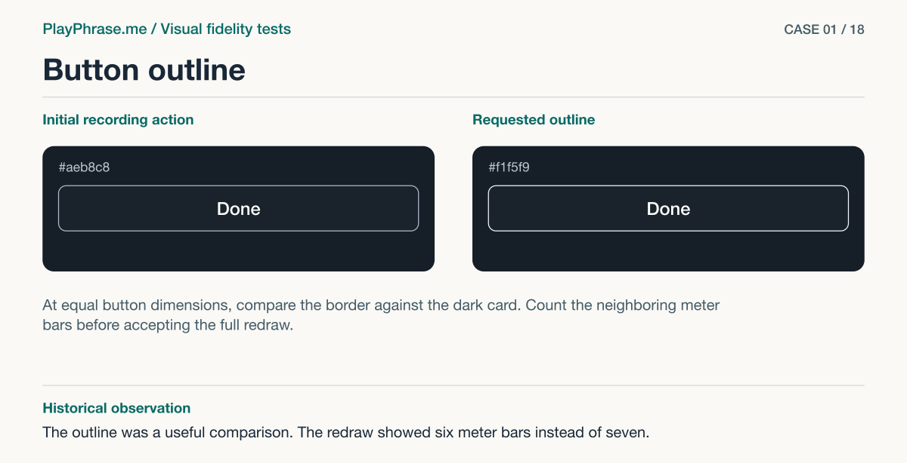

# 01 · Button outline

**Historical outcome · Rejected.** The outline was a useful comparison. The redraw showed six meter bars instead of seven.



[See the English ImageGen redraw and review note](../imagegen/README.md#case-01)

## Attach these inputs in order

1. `inputs/after-mobile-short-card.jpg`
2. `inputs/reference-07-transcript.png`

The [input inventory](../INPUTS.md) identifies the original files. The figure above is a documentation diagram based on the historical review. Measurements belong to the original locale and viewport.

## English test prompt

```text
English edition. Render every user-interface label, caption, callout, diagnostic note and footer in English. Translate any localized interface copy in the reference images. Preserve actual spoken words, recognition errors, attempt values, units and measurement provenance. Treat source-locale geometry as historical evidence.

Use case ui-mockup: targeted visual fidelity correction of just the in-chat pronunciation card. First reference is an actual localhost HTML mobile card captured after the first implementation pass. Second is the accepted design sheet, ONLY use the recording card for hierarchy and color. Produce a single horizontal annotated engineering comparison sheet, four regions: TOP LEFT schematic redraw of the supplied actual English recording card, TOP RIGHT same card aligned to the accepted target. Both keep native Card proportions, same scene and cropped video, same data exactly "Now repeat" / "You are not going." / "Hearing" / "O" / "Done". Both have exactly seven rising rounded meter bars by the heading, cyan dot, close X, static grey disk behind cyan microphone, actions. NO additions or deletions. Original partial hypothesis O is real, keep it verbatim. The ONLY remaining visual correction in this sheet is the stroke on the Done button: make it near-white as in the accepted target. No invented score, controls, subtitles or final text. Correcting accepted fidelity only. English annotations, exact captions "Updated HTML (redrawn)" and "Accepted reference 07". White background, neat technical type, full unclipped sheet.
MANDATORY LOWER-PANEL DETAIL, preserve exact copy:
Lower LEFT panel heading “Keep” with text: “Film height 250 CSS px. Seven bars in a 40 CSS px strip. Microphone disk 48 CSS px. Button height 44 CSS px.”
Lower RIGHT panel heading “Change” with text: “Done border #aeb8c8 → #f1f5f9. Keep the 1 CSS px stroke, size and position.”
Footer exact “Comparison mockup. Both cards are redrawn.”
MANDATORY GRAPHICAL LAYER: magenta double-ended DIMENSION arrows OUTSIDE EACH upper card with clear extension lines, exactly top to bottom VIDEO edges, not card edges. LEFT label “250 CSS px · measured”, RIGHT label “250 CSS px · target”. On EACH use dashed blue center guide linking circle center and video frame center (interrupt over icon, no line through text). On each draw segmented blue region brackets under or alongside the UI grouping header, video, text and button, region labels “Header / Video / Text / Button”, no numerical widths. Leader ending at the actual button BORDER on LEFT label “#aeb8c8”, on RIGHT “#f1f5f9”. Use dark product UI palette, stable source typography and retained action area. Do not draw a two-card comparison with no lower panels. Upper UI text English. Preserve lower panels legibly and accurately.
```

[All examples](../README.md#prompt-index)
