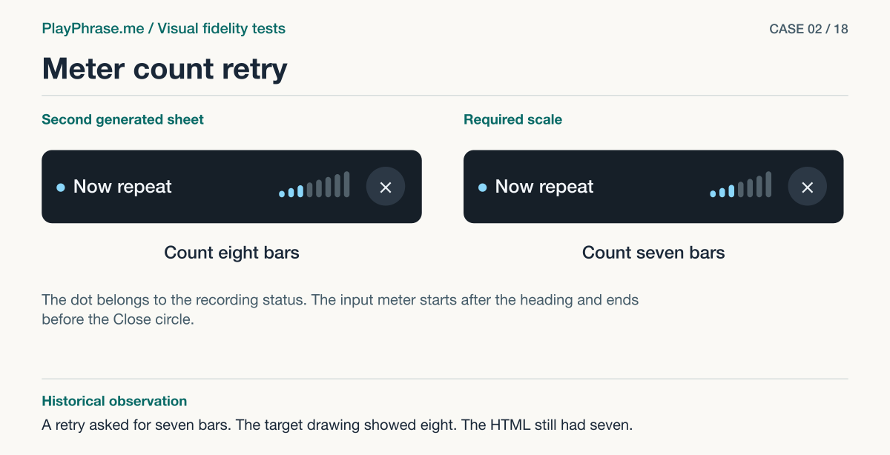

# 02 · Meter count retry

**Historical outcome · Rejected.** A retry asked for seven bars. The target drawing showed eight. The HTML still had seven.



[See the English ImageGen redraw and review note](../imagegen/README.md#case-02)

## Attach these inputs in order

1. `inputs/correction-1.png`
2. `inputs/after-mobile-short-card.jpg`
3. `inputs/reference-07-transcript.png`

The [input inventory](../INPUTS.md) identifies the original files. The figure above is a documentation diagram based on the historical review. Measurements belong to the original locale and viewport.

## English test prompt

```text
English edition. Render every user-interface label, caption, callout, diagnostic note and footer in English. Translate any localized interface copy in the reference images. Preserve actual spoken words, recognition errors, attempt values, units and measurement provenance. Treat source-locale geometry as historical evidence.

Edit the FIRST comparison sheet as a narrowly scoped correction. Second input is the real mobile HTML screen crop. Third is accepted reference 07. Preserve the first sheet intact, with its layout, legible text, photograph composition, captions, lower preserve/change panels, footer, blue brackets, dimension arrows, alignment guides and button stroke comparison. Correct exactly one count error: both HTML headers in the first sheet show SIX vertical capsules, but product requires SEVEN. Draw precisely seven, all visible and separated, with heights rising monotonically from left to right. Think of seven x positions each filled by exactly one rounded bar 1,2,3,4,5,6,7. Three active cyan then four gray. The dot before the title is NOT one of the bars. Do not add any count numerals, letters or marks to the UI. Keep original guide drawing and quantitative recipes, no other content changes. Footer as shown. Verify seven distinct vertical bar objects on both sides before exporting.
```

[All examples](../README.md#prompt-index)
