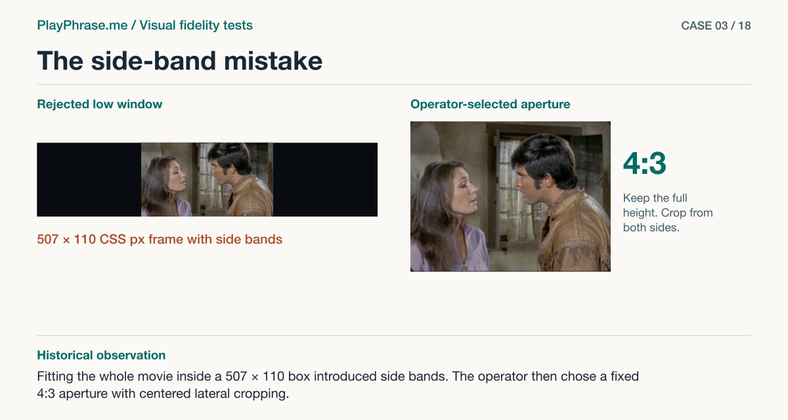

# 03 · The side-band mistake

**Historical outcome · Rejected by the operator.** Fitting the whole movie inside a 507 × 110 box introduced side bands. The operator then chose a fixed 4:3 aperture with centered lateral cropping.



[See the English ImageGen redraw and review note](../imagegen/README.md#case-03)

## Attach these inputs in order

1. `inputs/floating-clipped-result-card.jpg`
2. `inputs/verified-floating-result-card.jpg`
3. `inputs/reference-07-transcript.png`

The [input inventory](../INPUTS.md) identifies the original files. The figure above is a documentation diagram based on the historical review. Measurements belong to the original locale and viewport.

## English test prompt

```text
English edition. Render every user-interface label, caption, callout, diagnostic note and footer in English. Translate any localized interface copy in the reference images. Preserve actual spoken words, recognition errors, attempt values, units and measurement provenance. Treat source-locale geometry as historical evidence.

Annotated comparison of the RESULT state of a pronunciation card inside a low floating DESKTOP window. Inputs are two REAL crops of the same ordinary UI and the accepted reference sheet 07. 1 = before framing correction, 2 = implementation after framing repair, 3 = accepted hierarchy. Build a single engineering sheet following the first two actual desktop card proportions, same scale, data and English labels. UI English should copy actual result exactly, including neutral 'You', green 'are not going', neutral period, Recognized / O K YOU ARE NOT GOING / Match: 98% / Some words are not graded yet. / Repeat. No meter or microphone in result. Upper left caption “Before the framing correction” and upper right “Target result”. Actual original movie is 1280×715. Same low viewport in both: 507 × 110 CSS px, same woman and man. Left image zoom/crop cuts off top and bottom. Right inner movie is centered top to bottom at true proportions, ~197 × 110 CSS px surrounded by black side margins inside the frame. Right result heading has cyan dot. Keep dark theme. No redesign.
MANDATORY annotated sheet with two lower panels and drafting layer. Exact lower left heading “Keep” and copy “Video area 507 × 110 CSS px. Button height 44 CSS px. The score and transcript belong to this attempt.” Exact lower right heading “Change” and copy “Switch the film from fitting the width to fitting the height. Center it and keep the top and bottom in view. Add a blue dot before the result heading.”
On BOTH upper views: magenta double-ended vertical measurement arrow with witnesses from top edge to bottom edge of VIDEO area outside UI, label “110 CSS px”. Blue brackets with labels marking “Video” vs “Text and action”. Dashed vertical centerline on video, interrupted at faces. In RIGHT add a short leader to side margin “Side bands”. Preserve all these visible marks, use measured dimensions exactly, no extra dimensions. Footer “ImageGen mockup. Both cards are redrawn.” Keep all annotation text legible, no clipped graphics.
```

[All examples](../README.md#prompt-index)
