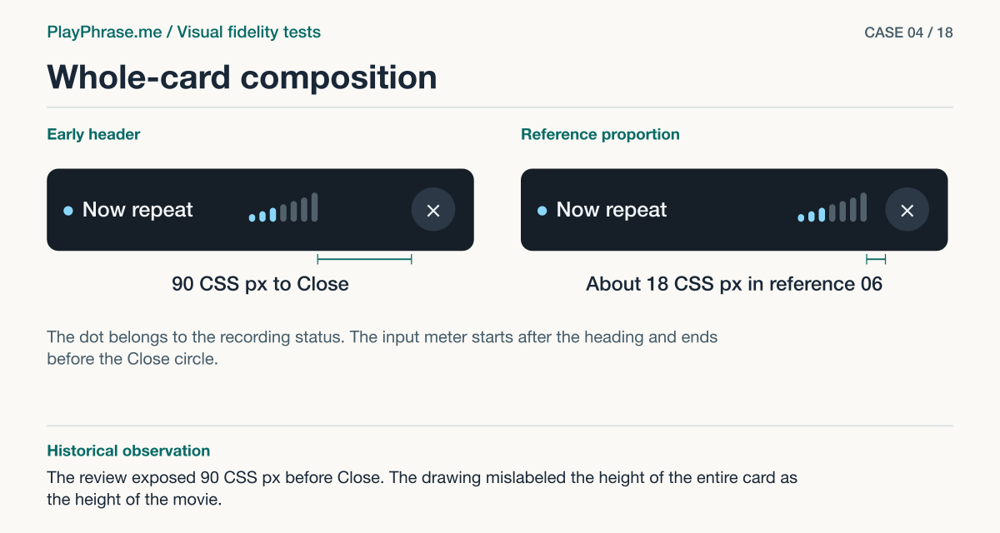

# 04 · Whole-card composition

**Historical outcome · Partial.** The review exposed 90 CSS px before Close. The drawing mislabeled the height of the entire card as the height of the movie.



[See the English ImageGen redraw and review note](../imagegen/README.md#case-04)

## Attach these inputs in order

1. `inputs/ru-rio-43-v1-card.jpg`
2. `inputs/reference-07-transcript.png`
3. `inputs/reference-06-volume-meter.png`

The [input inventory](../INPUTS.md) identifies the original files. The figure above is a documentation diagram based on the historical review. Measurements belong to the original locale and viewport.

## English test prompt

```text
English edition. Render every user-interface label, caption, callout, diagnostic note and footer in English. Translate any localized interface copy in the reference images. Preserve actual spoken words, recognition errors, attempt values, units and measurement provenance. Treat source-locale geometry as historical evidence.

Perform a critical, element-by-element VISUAL FIDELITY REVIEW as a senior UI designer. Do not merely illustrate a preselected change. Compare the actual card in input 1 with accepted reference 07 (input 2), using reference 06 (input 3) specifically for the seven-bar scale. Inspect the bounding edges of the card, top/bottom spacing, radius, typography at EACH level, status dot, title, scale's location with respect to both title and close, shape of individual capsules and their bottom alignment, size of close icon relative to circle, frame, overlay, left edges of film/caption/transcript/action, successive vertical gaps, and button form. Determine independently which visual discrepancies are material; diagram and name them including any additional discrepancy not listed below. Return a CORRECTED target consistent with these references and findings. The user's latest explicit requirement overrides the drawn video proportions: 4:3, center fill, crop lateral overflow, no side bands, same width across listening/record/check/result. Keep REAL words and actors from input 1: “Now repeat”, “You are not going.”, “Hearing”, “O K YOU”, “Done”. No imagined transcription/score. Only one recording card on each side. In the corrected view show exactly seven ascending, distinct, round-ended vertical capsules beside the localized heading and Close. Split the available header as in 06/07; don't add unrelated controls, counters, or status text. Alignments adapt to width and long labels. This is visual evidence, not an HTML screenshot.
Make a large readable FOUR-region annotated technical sheet in English. Top captions exactly “Current implementation” / “Accepted reference”. Match upper card width, state, content, theme and film. Bottom left “Keep” exact base copy: “Film 333 × 250 CSS px, aspect ratio 4:3. Microphone 34–37 CSS px inside a 48 CSS px disk. Both actions are accessible.” Bottom right “Change” exact base copy: “There are currently 90 CSS px of empty space before Close. Keep the meter, title and Close on one row, as on sheet 06. The meter is currently 40 × 22 CSS px. Match its width, pitch and silhouette to the reference. Compare spacing and type sizes throughout the card against sheet 07.” Then ADD a diagnostic key with YOUR own additional specific findings in English. Use labels outside the actual product UI, not inside any button. Supplied measured values in CSS pixels, no invented target pixels; use direction or relational arrows when target is visual. For context only current title 18px/600, main phrase 22px/650, hearing label 15px/500, hearing text 19px/400, actual Done 44px high; current capsule bars width 4px with 2px gaps and heights 5,8,10,13,16,19,22px. Accepted sheet 06 calls width "~40px" but the drawing relative to the original localized title and Close must be compared; flag that apparent tension rather than blindly matching the literal number. Evaluate corners, rhythm, contrast and sizing without arbitrarily restyling. Preserve long-phrase wrap and accessible click areas. Use a proper drafting layer on BOTH panels: magenta paired dimension arrows and witnesses for FRAME HEIGHT label “250 CSS px”, accurate arrow spanning EMPTY horizontal space from final capsule to PAINTED close circle: left label “90 CSS px · measured”, right “Gap on sheet 06”. Blue brackets identify “Heading / Video / Original line / Transcript / Action”. Centerline connects dot, title line-box, meter group and close, interrupted over glyphs. Leader lines to differing parts; also draw baseline guide at FOOT of the capsules. Keep all material findings legible, no invented numeric CSS targets. Footer “ImageGen review mockup. Both cards are redrawn.”
```

[All examples](../README.md#prompt-index)
