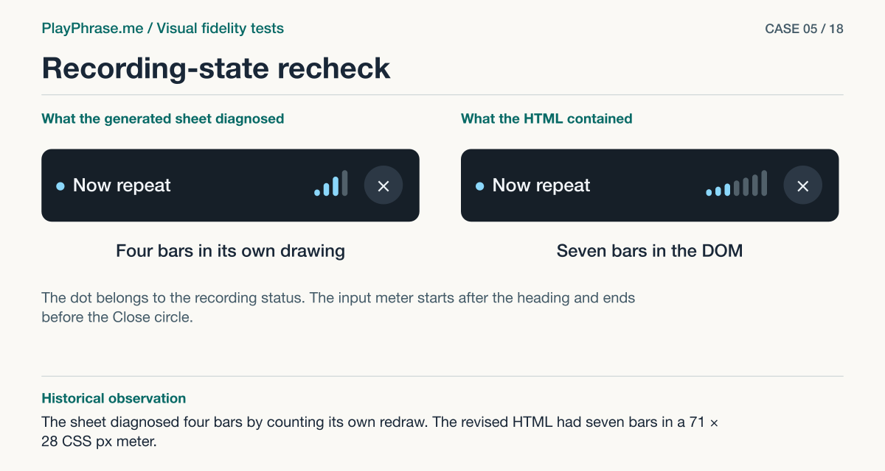

# 05 · Recording-state recheck

**Historical outcome · Rejected.** The sheet diagnosed four bars by counting its own redraw. The revised HTML had seven bars in a 71 × 28 CSS px meter.



[See the English ImageGen redraw and review note](../imagegen/README.md#case-05)

## Attach these inputs in order

1. `inputs/audit-mobile-3-recording-card.jpg`
2. `inputs/reference-07-transcript.png`
3. `inputs/reference-06-volume-meter.png`

The [input inventory](../INPUTS.md) identifies the original files. The figure above is a documentation diagram based on the historical review. Measurements belong to the original locale and viewport.

## English test prompt

```text
English edition. Render every user-interface label, caption, callout, diagnostic note and footer in English. Translate any localized interface copy in the reference images. Preserve actual spoken words, recognition errors, attempt values, units and measurement provenance. Treat source-locale geometry as historical evidence.

You are a visual design reviewer auditing the ENTIRE actual revised recording card vs accepted reference, without assuming the implementation is complete. Input 1 is the REAL updated mobile HTML card with the final repaired grid. Input 2 sheet 07 specifies accepted typography and composition, input 3 sheet 06 specifies the seven bar forms. Identify any remaining substantive mismatches by element. Render the corrected matching target, and state any residual in your own new diagnostic key. Do not stamp a PASS, invent new features or make changes for their own sake. All four top-to-bottom groups must be legible: heading with dot/title/meter/X, film with overlay, phrase + hearing, outline Done. Show two upper cards same scale, theme, real content; keep the clip from input 1 and its actual text as-is. User explicitly fixed the inner video to 4:3 even though the accepted drawings have different aspect ratios. Seven gap-separated ascending capsules. The 06 illustration (7 bars) overrides the inaccurate count in 07.
Mandatory 4-region comparison: top left caption “Current implementation”, top right “Accepted reference”. Lower left “Keep”, exact copy: “Film 333 × 250 CSS px, 4:3. Microphone 34–37 CSS px inside a 48 CSS px disk. Check that both film edges align with the button.” Lower right “Change”, exact copy preserving the completed implementation recipe: “Meter-to-Close gap 90 → 12 CSS px (−78). Meter strip 40 × 22 → 71 × 28 CSS px. Bar width 4 → 6.7 CSS px. Align the bottoms of all seven bars.” Add your independent evaluation of any remaining differences in typography, button, headings, spacing, circle, baseline and meter shape below in concise English; if none compare specific relationships. Keep unknown target figures qualitative, no invented fixed pixels.
Mandatory graphical layer: on both upper cards add two clear magenta extension lines placed ONLY at the top and bottom edge of the MOVIE PHOTO, leave the header above them and the entire text/action block below. Double-ended arrow MUST terminate exactly at these two extensions, label “250 CSS px”. Never measure the whole card. Another arrow between RIGHT EDGE of last bar and LEFT EDGE of PAINTED CLOSE CIRCLE, no glyph cross, label “12 CSS px · measured” on left and “Gap on sheet 06” on right. Dashed guides under the BOTTOM edges of bars and near center of header, interrupted when they cross glyphs. Blue region brackets for heading, film, text, action on both. Do not shrink or clip the lower note panels. Footer “ImageGen mockup. Both cards are redrawn.”
```

[All examples](../README.md#prompt-index)
