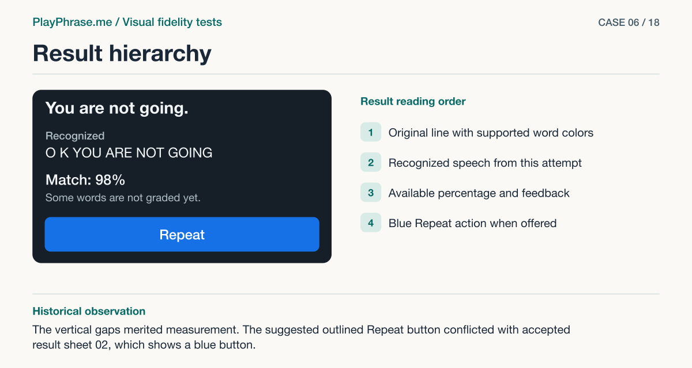

# 06 · Result hierarchy

**Historical outcome · Partial.** The vertical gaps merited measurement. The suggested outlined Repeat button conflicted with accepted result sheet 02, which shows a blue button.



[See the English ImageGen redraw and review note](../imagegen/README.md#case-06)

## Attach these inputs in order

1. `inputs/audit-mobile-3-result-card.jpg`
2. `inputs/reference-07-transcript.png`

The [input inventory](../INPUTS.md) identifies the original files. The figure above is a documentation diagram based on the historical review. Measurements belong to the original locale and viewport.

## English test prompt

```text
English edition. Render every user-interface label, caption, callout, diagnostic note and footer in English. Translate any localized interface copy in the reference images. Preserve actual spoken words, recognition errors, attempt values, units and measurement provenance. Treat source-locale geometry as historical evidence.

Audit the ENTIRE result state against sheet 07: input 1 is a real mobile 367 CSS px-wide result card, input 2 right panel is the accepted design reference. Analyze all differences including exact relative positions, status dot, icon size and spacing, heading/phrase/transcript/score/hint type sizes, content insets, gap from photo to phrase, grouping of final text and score, hierarchy of current Repeat action. Identify any remaining material differences independently; do NOT just agree that it matches. Generate a usable surgical correction using the accepted reference. Both upper views must use ACTUAL result data: “Result”, source phrase “You are not going.” with You neutral, are/not/going green, neutral period; “Recognized”, “O K YOU ARE NOT GOING”, “Match: 98%”, “Some words are not graded yet.”, “Repeat”. Do not transplant 92%, an invented red word or subtitle text into the transcript. Preserve existing functional Repeat action even though sheet 07 only illustrates the top. No microphone or level indicator in the result. Fixed video 4:3 is a later direct user decision: make the film 333:250 at full card inner width. Keep same actual film image in both. Reproduce dark product palette, English interface.
Produce 4-region annotated sheet: top left “Current implementation”, top right “Accepted reference”; lower left “Keep” exact content “Film 333 × 250 CSS px, 4:3. Show the full original line, transcript and result of this attempt. Keep Repeat accessible.” Lower right “Change” exact intro “Check the heading, original line, label, transcript, percentage and action separately. Use the left edge of the film and the start of the main text as guides.” Then add YOUR independent specific findings and directions for the remaining differences in English. Only label exact target CSS dimensions when measured or mandated, not guessed from generated art. Current CSS font values for reference: heading 22.5, phrase 29.5, transcript label 19, live/final text 23.3, score 19, feedback 17, primary Repeat label 14. Use native wrapping, no pills, new labels or invented controls.
Mandatory drafting overlays on EACH upper view: thin magenta double-ended arrow with perpendicular witnesses at just TOP and BOTTOM edges of the film photo, labelled “250 CSS px”. Do not attach to outer card edges. Blue region brackets “Heading / Video / Original line / Transcript / Result / Action”, dashed vertical alignment guides at the left edge of image vs phrase vs recognized block. Add leader callouts for your concrete differences. Lower notes clearly readable, no missing instructions. Footer “ImageGen mockup. Both cards are redrawn.”
```

[All examples](../README.md#prompt-index)
