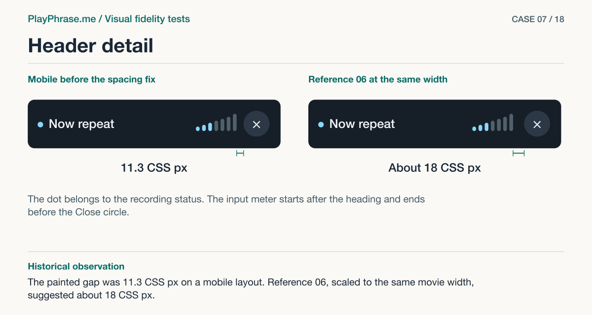

# 07 · Header detail

**Historical outcome · Useful finding.** The painted gap was 11.3 CSS px on a mobile layout. Reference 06, scaled to the same movie width, suggested about 18 CSS px.



[See the English ImageGen redraw and review note](../imagegen/README.md#case-07)

## Attach these inputs in order

1. `inputs/header-actual-enlarged.jpg`
2. `inputs/accepted-06-header.png`
3. `inputs/final-mobile-recording-card.jpg`
4. `inputs/reference-07-transcript.png`

The [input inventory](../INPUTS.md) identifies the original files. The figure above is a documentation diagram based on the historical review. Measurements belong to the original locale and viewport.

## English test prompt

```text
English edition. Render every user-interface label, caption, callout, diagnostic note and footer in English. Translate any localized interface copy in the reference images. Preserve actual spoken words, recognition errors, attempt values, units and measurement provenance. Treat source-locale geometry as historical evidence.

Perform a bounded retry of the visual fidelity review narrowed to the HEADER. The previous generated sheet miscounted bars after redrawing them. Explicit input roles: 1 enlarged ACTUAL header (RU, real HTML), 2 accepted header 06 (RU), 3 actual full component with 4:3 film, 4 accepted full 07 (only context). The first TWO images are the authoritative actual and target for comparison; do not mistake your own illustration for either. Both supplied first two header strips have SEVEN individually visible capsules and a SEPARATE dot at the left. Analyze positioning, optical alignment and geometry using the actual two strips side by side. Compare at equal inner film width. Render only the two UPPER HEADER STRIPS at large scale; do NOT draw a full film/card here. Leave wide blank space for notes. Copy the original pixels of the two header strips as closely as possible. Show a horizontal 7-segment bracket below each header and label 1 2 3 4 5 6 7 OUTSIDE the product header connected to each discrete bar. Do NOT add numerals inside the UI. This comparison specifically asks you to draw 7 gray separate curves in BOTH upper strips, increasing smoothly exactly as in inputs 1 and 2. The whole card input provides context only; do not replace this zoom with a full card illustration.
An actual audit, not a cosmetic proposal. Critique whether the title weight, dot/title spacing, rising rounded silhouette, level baseline and close icon's visual size follow 06, and note anything that differs independently. Current measured in the 390 CSS px viewport: meter 69 × 27 CSS px, 7 bars each 6.5 CSS px, gap to circle 11.3 CSS px. On sheet 06 at the same inner width, the last-bar-to-circle gap corresponds approximately to 18 CSS px, a normalized IMAGE comparison not a mandated universal value. Use these CLEARLY LISTED data as source, identify current-to-target optical delta without inventing evidence. Source drawings outrank generated notes. Compare optical spacing to 07 too.
FOUR regions upper left “Current implementation”, upper right “Accepted reference”. Lower left “Keep” exact copy “Seven bars share one baseline. At this width the strip measures 69 × 27 CSS px and each bar is 6.5 CSS px wide.” Lower right “Change” exact copy “The gap from the last bar to the circle is now 11.3 CSS px, compared with about 18 CSS px when sheet 06 is scaled to the same width. Refine the gap and test the long heading.” Include your independent conclusion on other elements in English below. Only relevant to header; no numeric changes to rest of product. BOTH upper views need magenta arrows with witness lines attached EXACTLY to painted last bar's right edge and painted circle's left edge, left “11.3 CSS px · measured”, right “≈18 CSS px · sheet 06”. Width arrow spans first through seventh capsule on left “69 CSS px · measured”, corresponding right “Meter on sheet 06”. Place blue brackets under each “Dot / Heading / Meter / Close”. Draw a thin dashed baseline at the foot of the bars and a center line at the center of the status dot. Arrows must not cover header text. Footer “ImageGen mockup. Header review.”
```

[All examples](../README.md#prompt-index)
