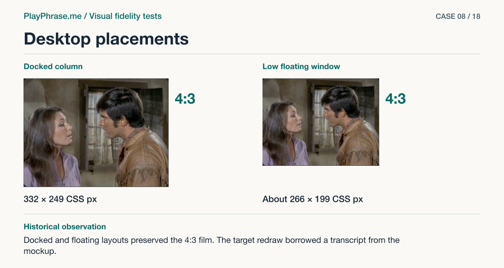

# 08 · Desktop placements

**Historical outcome · Partial.** Docked and floating layouts preserved the 4:3 film. The target redraw borrowed a transcript from the mockup.



[See the English ImageGen redraw and review note](../imagegen/README.md#case-08)

## Attach these inputs in order

1. `inputs/review-float-states.png`
2. `inputs/review-dock-states.png`
3. `inputs/reference-07-transcript.png`
4. `inputs/reference-06-volume-meter.png`
5. `inputs/accepted-cycle-result-video.png`

The [input inventory](../INPUTS.md) identifies the original files. The figure above is a documentation diagram based on the historical review. Measurements belong to the original locale and viewport.

## English test prompt

```text
English edition. Render every user-interface label, caption, callout, diagnostic note and footer in English. Translate any localized interface copy in the reference images. Preserve actual spoken words, recognition errors, attempt values, units and measurement provenance. Treat source-locale geometry as historical evidence.

Whole-component visual fidelity audit of the ENTIRE real pronunciation widget vs the same accepted reference. Across the WHOLE component, which material differences do you see, including any I have not named? Inspect actual source pixels, never diagnose from your redrawing. Check every state (ready, listening, recording, checking, result) in BOTH actual HTML contact sheets, in order left to right. Gray below a shorter card is contact-sheet canvas, not UI. Compare order, placement, spacing, type, framing, visible controls, state indicators, long lines and responsiveness against reference 07 (main recording/result), 06 (seven meter capsules), and grouped 01+02+04 (historical states, blue Start and Repeat still apply). The new mandatory film size is 4:3 across all states, no bars and no overlay video controls, despite the old reference details. Only supplied real words and current attempt data, do not restore illustration numbers/colors from mockups. Do not normalize away real platform or locale adaptations. Report concrete residuals independently, including any outside known leads; distinguish verified or intentional differences. For the annotation drawing reproduce recording state from the first film, in two FULL upper cards at equal size, not just header cutouts. Exactly seven separate rounded meter capsules, separate dot and close circle. Preserve every zone: heading, video and mic, original, hearing line, bottom action. Lower text panels below and a short English audit key for BOTH layouts/sizes and all stages if there are any additional issues. Captions upper left “Current implementation”, upper right “Accepted reference”, lower left “Keep”, lower right “Change”. Annotate outside UI using magenta double-ended arrows with perpendicular extensions between TOP and BOTTOM edges of VIDEO only “4:3 · frame”, on BOTH views. Blue brackets “Header / Video / Original and transcript / Action”; dashed bottom alignment guide below meter capsules, separate left-edge guide between movie and button, leader points to any backed residual. Use only supplied CSS values, no invented requirements. Footer “ImageGen mockup. Both cards are redrawn.”
Context floating: 265.7 × 199.3 CSS px; column: 332.4 × 249.3 CSS px. Both in IAB desktop 1163 × 818 CSS px. First and second sheets respectively. Genuine Rio Lobo. Narrow floating/scrollable card uses its whole width. In floating, when taller than the scroller, the full component was assembled from two real scroll positions of that same state/attempt. Film did not move/change size with the state. All 5 states are supplied in BOTH placements.
Exact lower Preserve block: “The video measures 332 × 249 CSS px when docked and 266 × 199 CSS px in the floating window. It keeps 4:3 in all five states. Text and actions stay in the card.”
Exact lower Change block: “Align seven capsules along one baseline. The gap to Close is 18 CSS px in the docked column and 14 CSS px in the short window. Check the other regions against the same sheets.”
```

[All examples](../README.md#prompt-index)
