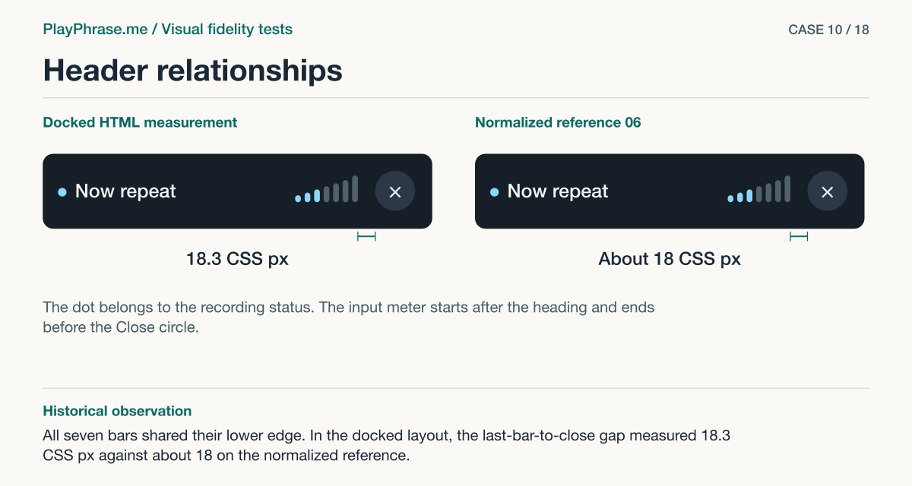

# 10 · Header relationships

**Historical outcome · Verified in HTML.** All seven bars shared their lower edge. In the docked layout, the last-bar-to-close gap measured 18.3 CSS px against about 18 on the normalized reference.



[See the English ImageGen redraw and review note](../imagegen/README.md#case-10)

## Attach these inputs in order

1. `inputs/detail-header.png`
2. `inputs/part-heading-06.png`

The [input inventory](../INPUTS.md) identifies the original files. The figure above is a documentation diagram based on the historical review. Measurements belong to the original locale and viewport.

## English test prompt

```text
English edition. Render every user-interface label, caption, callout, diagnostic note and footer in English. Translate any localized interface copy in the reference images. Preserve actual spoken words, recognition errors, attempt values, units and measurement provenance. Treat source-locale geometry as historical evidence.

Produce one paired DETAIL fidelity sheet for part header of a real product card. Inputs are paired crops of the exact named part: first actual localhost, second accepted, third if present established action reference. Compare both crops at comparable parent/content scale; keep common parent, both facing edges, relevant neighbors visible. For EACH named element and EACH relationship compare actual property vs accepted (or normalized) basis and state matches / differs / unverified for actual source pixels. Do not measure the redrawn illustration. Give concise diagnostic notes in English if any material difference exists, including unlisted ones. Localized recording header, both parent rows and the start of the film below. Inspect dot, title, 7 capsule bars, close circle and cross separately. Inspect dot/title, title/first bar, last bar/painted circle, common lower bar line, optical centerline and header/film gap. Whole card width 366 CSS px. Current values: title one line, gap label track to first bar 9 CSS px, final capsule to circle 18.3 CSS px (about 18–19 in reference 06 scaled to this film width). 7 distinct bars about 6.7 CSS px wide, 4 CSS px gap, heights 7→28. Circle 44 CSS px click area, visual X center. Dot-title gap about 9. Reference crop is high resolution compared to current; normalize the inner film width first. Color of lit bars depends on actual input. Same fixed visible width of video.
Four annotated regions. Top “Current implementation” and “Accepted reference”, show the complete scope of this PART on both sides, keep real labels. Bottom left “Keep” and exact base copy “Keep the seven bars on a common baseline and the 44 CSS px Close circle.”. Bottom right “Change” exact base copy “The old gap changes from 90 to 18.3 CSS px (−71.7). Check both facing edges and heading wrap.”; add factual residual/outcome for each relation in a compact measurement key, no invented numeric CSS targets. Both views have magenta double-ended dimension arrows with perpendicular witnesses on the named endpoints: last right edge of capsule to painted circle; “18.3 CSS px · measured” left / “≈18 CSS px · reference 06” right. Do not span letters or controls when measuring empty space. Both get blue brackets for named elements, dashed baseline/edge alignment guide, leaders to specific elements. Use supplied values, keep only native drawing colors inside UI, notes outside, legible. Do not invent new behavior or synthetic app data. Footer “ImageGen mockup. Detail review.”
```

[All examples](../README.md#prompt-index)
