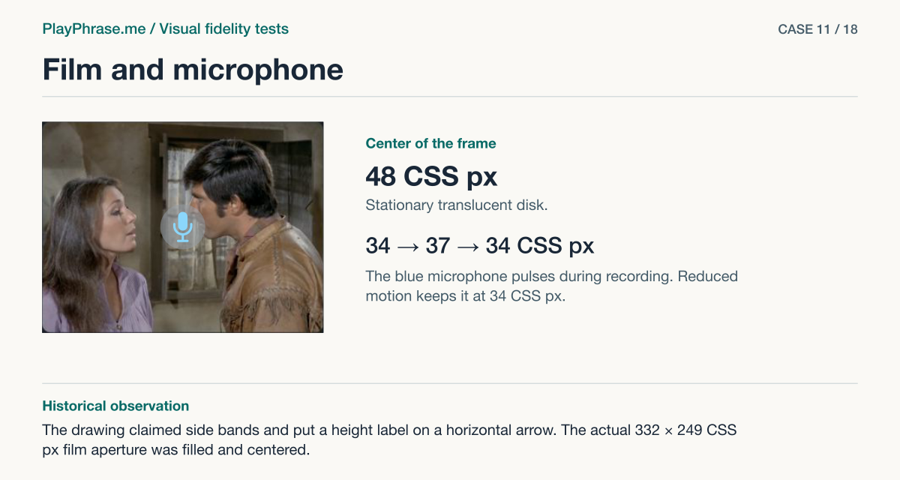

# 11 · Film and microphone

**Historical outcome · Partial.** The drawing claimed side bands and put a height label on a horizontal arrow. The actual 332 × 249 CSS px film aperture was filled and centered.



[See the English ImageGen redraw and review note](../imagegen/README.md#case-11)

## Attach these inputs in order

1. `inputs/part-film-actual.png`
2. `inputs/part-film-07.png`

The [input inventory](../INPUTS.md) identifies the original files. The figure above is a documentation diagram based on the historical review. Measurements belong to the original locale and viewport.

## English test prompt

```text
English edition. Render every user-interface label, caption, callout, diagnostic note and footer in English. Translate any localized interface copy in the reference images. Preserve actual spoken words, recognition errors, attempt values, units and measurement provenance. Treat source-locale geometry as historical evidence.

Produce one paired DETAIL fidelity sheet for part film of a real product card. Inputs are paired crops of the exact named part: first actual localhost, second accepted, third if present established action reference. Compare both crops at comparable parent/content scale; keep common parent, both facing edges, relevant neighbors visible. For EACH named element and EACH relationship compare actual property vs accepted (or normalized) basis and state matches / differs / unverified for actual source pixels. Do not measure the redrawn illustration. Give concise diagnostic notes in English if any material difference exists, including unlisted ones. Film and microphone composite, keep top/bottom and neighboring first phrase in both crops. Examine frame edge against content edges, left/right clipping, vertical source integrity, center of mic disk vs frame center, glyph vs disk vs surrounding scene, bottom of video to first visible ink of phrase. Output target must use the later user-prescribed full 4:3, the old view's different aspect ratio is superseded, not a defect. In real dock frame 332×249, native 1280×715 covers vertically, about 57 displayed CSS px cropped on each side, 0 from top or bottom. Circle measured 48 CSS px fixed, glyph 34–37 px full cycle, centered on both axes. Do not interpret different generated poses of the actors as CSS offsets. Preserve the real film and real text.
Four annotated regions. Top “Current implementation” and “Accepted reference”, show the complete scope of this PART on both sides, keep real labels. Bottom left “Keep” and exact base copy “Keep the full film height, 4:3 frame, 48 CSS px disk and 34–37 CSS px microphone pulse.”. Bottom right “Change” exact base copy “Remove the previous side bands. Crop the wide scene equally, about 57 CSS px on each side. Check the frame, center and transition to the original line.”; add factual residual/outcome for each relation in a compact measurement key, no invented numeric CSS targets. Both views have magenta double-ended dimension arrows with perpendicular witnesses on the named endpoints: top/bottom of film photo only; “249 CSS px · measured” left / “4:3 · target” right. Do not span letters or controls when measuring empty space. Both get blue brackets for named elements, dashed baseline/edge alignment guide, leaders to specific elements. Use supplied values, keep only native drawing colors inside UI, notes outside, legible. Do not invent new behavior or synthetic app data. Footer “ImageGen mockup. Detail review.”
```

[All examples](../README.md#prompt-index)
