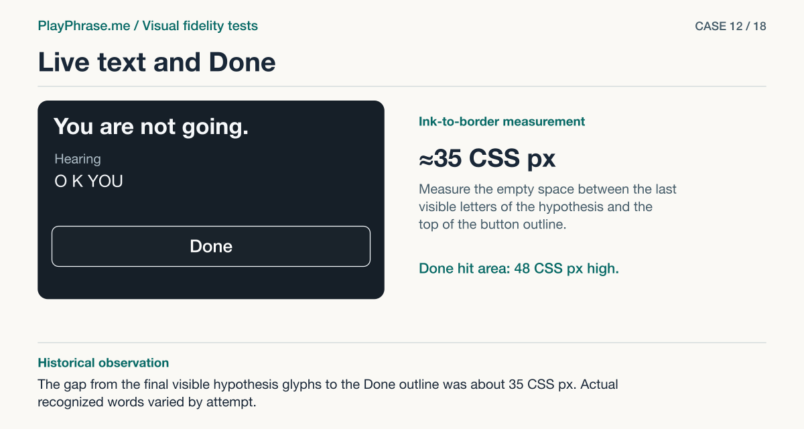

# 12 · Live text and Done

**Historical outcome · Verified in HTML.** The gap from the final visible hypothesis glyphs to the Done outline was about 35 CSS px. Actual recognized words varied by attempt.



[See the English ImageGen redraw and review note](../imagegen/README.md#case-12)

## Attach these inputs in order

1. `inputs/detail-text.png`
2. `inputs/part-text-07.png`

The [input inventory](../INPUTS.md) identifies the original files. The figure above is a documentation diagram based on the historical review. Measurements belong to the original locale and viewport.

## English test prompt

```text
English edition. Render every user-interface label, caption, callout, diagnostic note and footer in English. Translate any localized interface copy in the reference images. Preserve actual spoken words, recognition errors, attempt values, units and measurement provenance. Treat source-locale geometry as historical evidence.

Produce one paired DETAIL fidelity sheet for part text of a real product card. Inputs are paired crops of the exact named part: first actual localhost, second accepted, third if present established action reference. Compare both crops at comparable parent/content scale; keep common parent, both facing edges, relevant neighbors visible. For EACH named element and EACH relationship compare actual property vs accepted (or normalized) basis and state matches / differs / unverified for actual source pixels. Do not measure the redrawn illustration. Give concise diagnostic notes in English if any material difference exists, including unlisted ones. Recording lower half, include film bottom, original phrase, Hearing label, hypothesis line and button Done including bottom inset. Compare glyph sizes/weights, vertical rhythm, phrase and transcription inset relative to image edges, last ink to button top, outline vs hit target. Real words O K YOU must remain in BOTH redraws; 07 has illustrative words and other actors. Normalize by film width (332 CSS px); current original line ink starts about 16 CSS px below film, normalized 07 about 17 CSS px. The observed gap between last visible ASR ink and button outline is 35 CSS px, same approx 35 in reference. Caption glyph height 26 CSS px vs approx 26 in design. Actual button height 48 CSS px vs reference approx 47–48 CSS px. Match the parent hierarchy and do not move a label for the sake of changing paint.
Four annotated regions. Top “Current implementation” and “Accepted reference”, show the complete scope of this PART on both sides, keep real labels. Bottom left “Keep” and exact base copy “Keep the original line above Hearing, followed by Done. Button height 48 CSS px.”. Bottom right “Change” exact base copy “Compare the rendered letters and gaps. Allow about 16–17 CSS px below the film and about 35 CSS px before the button. Preserve the live transcript.”; add factual residual/outcome for each relation in a compact measurement key, no invented numeric CSS targets. Both views have magenta double-ended dimension arrows with perpendicular witnesses on the named endpoints: bottom ink of recognized line to button upper border, “35 CSS px · measured” left / “≈35 CSS px · reference” right. Do not span letters or controls when measuring empty space. Both get blue brackets for named elements, dashed baseline/edge alignment guide, leaders to specific elements. Use supplied values, keep only native drawing colors inside UI, notes outside, legible. Do not invent new behavior or synthetic app data. Footer “ImageGen mockup. Detail review.”
```

[All examples](../README.md#prompt-index)
