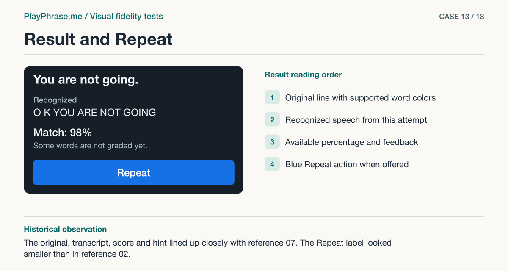

# 13 · Result and Repeat

**Historical outcome · Useful finding.** The original, transcript, score and hint lined up closely with reference 07. The Repeat label looked smaller than in reference 02.



[See the English ImageGen redraw and review note](../imagegen/README.md#case-13)

## Attach these inputs in order

1. `inputs/detail-result.png`
2. `inputs/part-result-07.png`
3. `inputs/part-repeat-02.png`

The [input inventory](../INPUTS.md) identifies the original files. The figure above is a documentation diagram based on the historical review. Measurements belong to the original locale and viewport.

## English test prompt

```text
English edition. Render every user-interface label, caption, callout, diagnostic note and footer in English. Translate any localized interface copy in the reference images. Preserve actual spoken words, recognition errors, attempt values, units and measurement provenance. Treat source-locale geometry as historical evidence.

Produce one paired DETAIL fidelity sheet for part result of a real product card. Inputs are paired crops of the exact named part: first actual localhost, second accepted, third if present established action reference. Compare both crops at comparable parent/content scale; keep common parent, both facing edges, relevant neighbors visible. For EACH named element and EACH relationship compare actual property vs accepted (or normalized) basis and state matches / differs / unverified for actual source pixels. Do not measure the redrawn illustration. Give concise diagnostic notes in English if any material difference exists, including unlisted ones. Result lower section: movie bottom, highlighted original, recognized label, final ASR, match percentage, feedback and blue Repeat. Second input 07 = top hierarchy, third input accepted 02 = blue repeat button in partial result, keep it. Inspect each element and each adjacent space and left edge; do not infer missing action from 07. Actual score 98%, You unknown, are/not/going green, real transcript O K YOU ARE NOT GOING; keep those actual data, not 92% and red invented error. At this scale, observed after film lower edge: original ink begins 16px (target ~15), label 63px (target ~63), transcript 90px (target ~89), score 135px (target ~134). ASR letter case and lengths differ, don't mark that a styling defect. Preserve 44px minimum action height. Blue repeat from 02. If you see a genuine extra discrepancy describe what specific edges or glyph properties differ.
Four annotated regions. Top “Current implementation” and “Accepted reference”, show the complete scope of this PART on both sides, keep real labels. Bottom left “Keep” and exact base copy “Keep the original line, transcript, percentage and hint separate. Use the blue Repeat button from sheet 02.”. Bottom right “Change” exact base copy “Measure the four text rows from the film's bottom edge at 16, 63, 90 and 135 CSS px. Distinguish spacing from changes in the actual words.”; add factual residual/outcome for each relation in a compact measurement key, no invented numeric CSS targets. Both views have magenta double-ended dimension arrows with perpendicular witnesses on the named endpoints: film lower edge to top ink of original; “16 CSS px · measured” left / “≈15 CSS px · reference 07” right. Do not span letters or controls when measuring empty space. Both get blue brackets for named elements, dashed baseline/edge alignment guide, leaders to specific elements. Use supplied values, keep only native drawing colors inside UI, notes outside, legible. Do not invent new behavior or synthetic app data. Footer “ImageGen mockup. Detail review.”
```

[All examples](../README.md#prompt-index)
