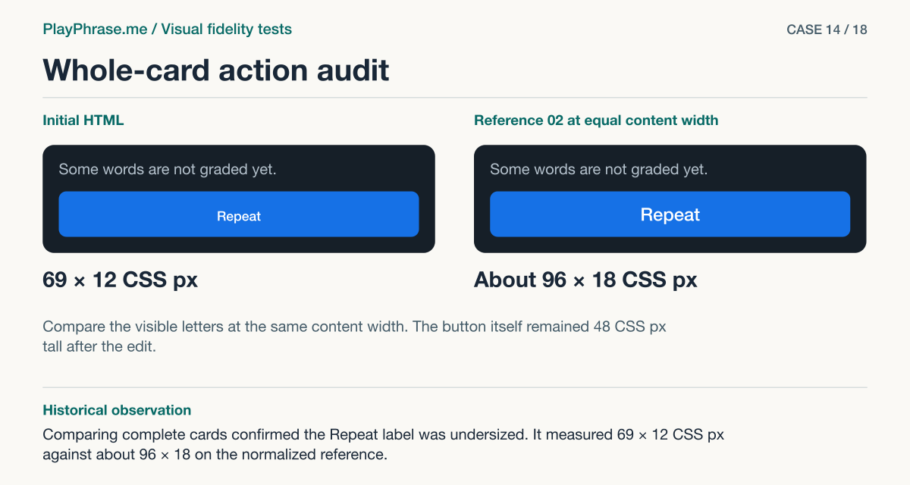

# 14 · Whole-card action audit

**Historical outcome · Useful finding.** Comparing complete cards confirmed the Repeat label was undersized. It measured 69 × 12 CSS px against about 96 × 18 on the normalized reference.



[See the English ImageGen redraw and review note](../imagegen/README.md#case-14)

## Attach these inputs in order

1. `inputs/matched-desktop.png`
2. `inputs/matched-mobile.png`
3. `inputs/reference-07-transcript.png`
4. `inputs/reference-06-volume-meter.png`
5. `inputs/accepted-cycle-result-video.png`

The [input inventory](../INPUTS.md) identifies the original files. The figure above is a documentation diagram based on the historical review. Measurements belong to the original locale and viewport.

## English test prompt

```text
English edition. Render every user-interface label, caption, callout, diagnostic note and footer in English. Translate any localized interface copy in the reference images. Preserve actual spoken words, recognition errors, attempt values, units and measurement provenance. Treat source-locale geometry as historical evidence.

Whole composite acceptance, after separate paired part audits. Input 1 ENTIRE real desktop cards (top docked, lower floating); input 2 ENTIRE real mobile cards (dark short, light short, light long); each row ready → listening → recording → checking → result. The gray beyond individual card edges is evidence-sheet canvas. Inputs 3 and 4 are the SAME accepted mockups 07 and 06; input 5 preserves original approved 01/02/04 state/function refs. Across the whole component, which material differences do you see, including any I have not named? Inspect each state/size, element by element plus the spacing edges between adjacent parts, then the composition: frame & mic, header & scale, original & ASR, score & hint, bottom controls & tap targets. Assess actual complete inputs, not your illustration. Source scenes, words, grades and colors are live; never compare a waveform reading or the sample 92% as if it were required. User requires constant 4:3, center fill, lateral crop, no bars, no controls; supersedes old drawings. Known part findings as leads only: seven capsules share baseline, 18px docked clearance to X, whole photo/phrase gap about 16px, 35px before Done; confirmed dimensional difference to examine — blue Repeat label appears materially smaller than accepted blue repeat in 02 (ink 69×12 vs normalized about 96×18 CSS px). Analyze any further residual independently; assign each finding to evidence, do not invent a CSS size from drawing. Show two WHOLE comparable upper RESULT cards (never just button crops), using input1 docked actual data “Result”, You unknown and are/not/going correct, final “O K YOU ARE NOT GOING”, “Match: 98%”, neutral short hint, “Repeat”. Include a key for all supplied variants, distinguishing actual differences from intended adaptations like tentative text and light theme.
English captions “Current implementation” / “Accepted reference”, bottom left “Keep” exact “Film 332 × 249 CSS px in the docked column, 4:3 in every state. The meter, Close, transcript and score all belong to this card.” Bottom right “Change” exact “Compare the Repeat label. Its letterforms currently measure 69 × 12 CSS px. Sheet 02 at the same width gives about 96 × 18 CSS px. Keep the button and its color.” Add your own comparative findings separately. Draw magenta arrows with precise witnesses on BOTH upper cards spanning VIDEO top to bottom only, label “4:3 · frame”, plus short arrow across actual width of Repeat TEXT (not entire button), Left “69 CSS px · measured”, right “≈96 CSS px · reference 02”. Mark blue brackets heading/film/text/result/action; dashed alignment guides for bottom action’s edges vs film edges. No dimension through a label. Footer “ImageGen mockup. Both cards are redrawn.”
```

[All examples](../README.md#prompt-index)
