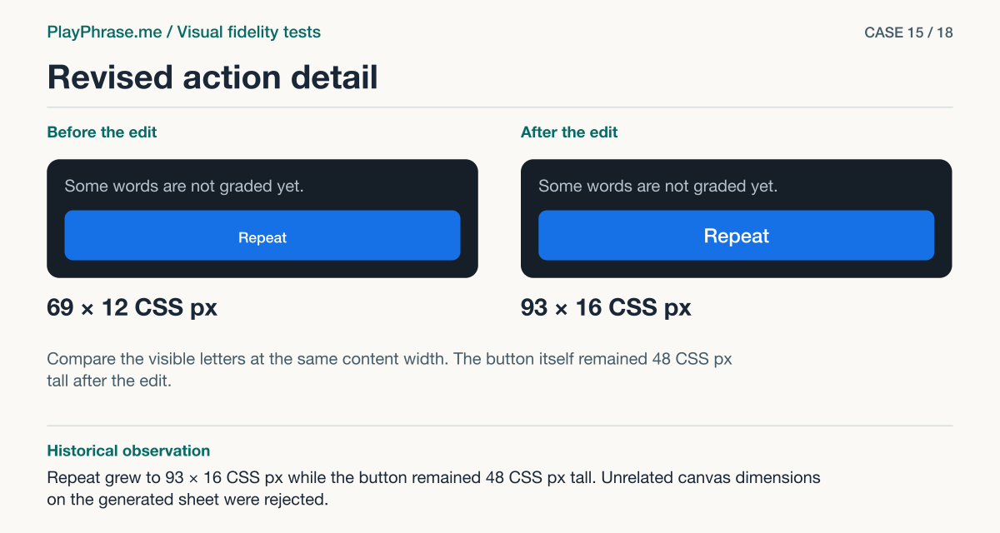

# 15 · Revised action detail

**Historical outcome · Verified in HTML.** Repeat grew to 93 × 16 CSS px while the button remained 48 CSS px tall. Unrelated canvas dimensions on the generated sheet were rejected.



[See the English ImageGen redraw and review note](../imagegen/README.md#case-15)

## Attach these inputs in order

1. `inputs/final-action-neighbors.png`
2. `inputs/part-repeat-02.png`
3. `inputs/final-start-neighbors.png`
4. `inputs/accepted-start-01.png`
5. `inputs/part-result-07.png`

The [input inventory](../INPUTS.md) identifies the original files. The figure above is a documentation diagram based on the historical review. Measurements belong to the original locale and viewport.

## English test prompt

```text
English edition. Render every user-interface label, caption, callout, diagnostic note and footer in English. Translate any localized interface copy in the reference images. Preserve actual spoken words, recognition errors, attempt values, units and measurement provenance. Treat source-locale geometry as historical evidence.

Paired detail review AFTER correcting the blue button labels. Compare real/reference crops of BOTH blue-action states, keeping parent and both edges of the gaps to adjacent text. Inputs 1 actual result action/hint, 2 accepted partial-result blue repeat (02), 3 actual start, 4 accepted start (01), 5 accepted result text hierarchy (07). Inspect text size/weight, optical centering, button top/bottom and its unchanged blue fill, spacing after feedback, left/right content edges and actual accessible height. For each named item and relationship, record actual→target basis and outcome (matches, differs, unverified). This is a confirmation of actual source geometry, do not rank educational scores. Measured actual final desktop Repeat ink 93 × 16 CSS px, before was 69 × 12. Equal-content-width normalized 02 reference ink approx 96 × 18 px. The fonts/rendering are not literally identical. Hit box is 48 CSS px high, above confirmed minimum 44. Data: real 98% neutral “Some words are not graded yet.”, repeat blue. Different words and colors in 02 are illustrative; never replace real data. Compare actual pixels not your own redrawing. Include the full bottom region (last adjacent line & both button edges as a unit) of the same result on both upper views with accurate dimensions outside. Four regions. Captions “Current implementation”, “Accepted reference”. Lower “Keep”: “Keep the blue button 48 CSS px high, centered and aligned to the content edges. Show the words and score for this attempt.” Lower “Change”: “The Repeat label changed from 69 × 12 to 93 × 16 CSS px. The equal-width reference is about 96 × 18. Check the label, hint and bottom inset.” Add any remaining material discrepancy independently, note if none. Graphical layer on BOTH upper regions: use magenta double-ended dimension line precisely from first to last INK of the word “Repeat” (not the button bounds), witnesses attached, left label “93 CSS px · measured”, right “≈96 CSS px · sheet 02”. Separate blue brackets for hint and action, dashed centerline at button center and aligned left edges, never over labels. Footer “ImageGen mockup. Action review.”
```

[All examples](../README.md#prompt-index)
