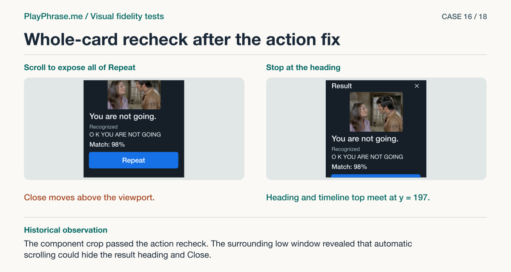

# 16 · Whole-card recheck after the action fix

**Historical outcome · Context check required.** The component crop passed the action recheck. The surrounding low window revealed that automatic scrolling could hide the result heading and Close.



[See the English ImageGen redraw and review note](../imagegen/README.md#case-16)

## Attach these inputs in order

1. `inputs/post-action-desktop.png`
2. `inputs/post-action-mobile.png`
3. `inputs/reference-07-transcript.png`
4. `inputs/reference-06-volume-meter.png`
5. `inputs/accepted-cycle-result-video.png`

The [input inventory](../INPUTS.md) identifies the original files. The figure above is a documentation diagram based on the historical review. Measurements belong to the original locale and viewport.

## English test prompt

```text
English edition. Render every user-interface label, caption, callout, diagnostic note and footer in English. Translate any localized interface copy in the reference images. Preserve actual spoken words, recognition errors, attempt values, units and measurement provenance. Treat source-locale geometry as historical evidence.

FINAL WHOLE-COMPONENT audit: Across the WHOLE component, which material differences do you see, including any not named? Check THIS revision, inspect every entire real card in inputs 1/2, not a previously redrawn sheet. Compare against the same accepted mockups in inputs 3/4/5. Explicitly consider open findings from the part sheets, the parts’ relationships, any new regression caused by the last change. The 5 full states in every actual row are ready, listening, recording, checking, result. Actual desktop rows docked and low floating at 1280×900; actual mobile rows dark 354×767, light 390×844, light 429×928 with 18 words. Gray pasteboard outside any real card is NOT UI. No speculative fictional corrections from a drawing. Compare image composition at equal content scale, account for the prescribed 4:3 frame overriding ratios in original paintings. No bars or controls. Preserve existing blue actions in the applicable states of 01/02 and outline Done in 07. Scope includes header/dot/label/meter/close, frames/mic, original/partial/final recognition, score/hint, buttons and their relative positions/size/spacing. Known verified values: header has seven rounded capsules with one lower baseline, gap at column size 18.3 CSS px, phone 390 gap 18.1 CSS px. Film 332×249 docked, 265×199 floating, 324×243 phone390. In the docked result, ink of “Repeat” was 69×12, now 93×16 CSS px, compared with approx 96×18 normalized 02 artwork. Blue button box 48 CSS px tall. Lower edge of video to original ink about 16 CSS px, to final transcript about 90 CSS px, to score about 135 CSS px, compare with 07. All visible final ASR and numeric/word verdicts in real inputs are actual; don't compare them with sample values. Changing actors, word colors and numbers in the reference are not design failures.
Output an annotated 4-region whole-card sheet, upper left “Current implementation”, upper right “Accepted reference”, actual and target full card from top all the way through the last action; choose SAME desktop docked RESULT state. In both use the actual “Result / You are not going. / Recognized / O K YOU ARE NOT GOING / Match: 98% / Some words are not graded yet. / Repeat”. In the whole card reproduce the actual input word colors, do not import 92% and an invented red error. Generations are schematic, not runtime captures. Lower left “Keep”: “4:3 video. Show this attempt's words, percentage and transcript. Blue button 48 CSS px high.” Lower right “Check the correction” (or “Change”): “Repeat label 69 × 12 → 93 × 16 CSS px. Reference ≈96 × 18 CSS px. Recheck all adjacent gaps.” Add an independent concise audit key that names actual remaining differences or no material discrepancy by group, including other captured states & sizes. BOTH upper views: magenta double-ended dimension line with correct witnesses attached to film TOP/BOTTOM (not the whole card) labeled “4:3 · video”, blue labeled brackets “Header / Video / Original and transcript / Result / Action”, dashed left-edge guide for film and button. Measure only supplied similar edges, no invented sheet-pixel dimensions, do not annotate through product text. Footer “ImageGen mockup. Both cards are redrawn.”
```

[All examples](../README.md#prompt-index)
