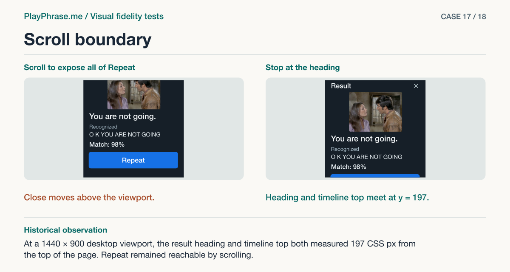

# 17 · Scroll boundary

**Historical outcome · Verified in HTML.** At a 1440 × 900 desktop viewport, the result heading and timeline top both measured 197 CSS px from the top of the page. Repeat remained reachable by scrolling.



[See the English ImageGen redraw and review note](../imagegen/README.md#case-17)

## Attach these inputs in order

1. `inputs/last-float-viewport.png`
2. `inputs/last-float-result-complete.png`
3. `inputs/reference-07-transcript.png`

The [input inventory](../INPUTS.md) identifies the original files. The figure above is a documentation diagram based on the historical review. Measurements belong to the original locale and viewport.

## English test prompt

```text
English edition. Render every user-interface label, caption, callout, diagnostic note and footer in English. Translate any localized interface copy in the reference images. Preserve actual spoken words, recognition errors, attempt values, units and measurement provenance. Treat source-locale geometry as historical evidence.

Paired detail audit of the corrected SCROLL POSITION in the low floating pronunciation result. Input 1: actual on-screen visible bounds of the scroller; input 2: entire real card from the same result captured in scroll positions; input 3: accepted 07 result as reference, no floating-window scroll position is specified by its illustration. Preserve accepted structure and assess the runtime relationship of the scroller's upper edge to header/title, full 44px close hit area, film upper edge, visible feedback and lower Repeat action reachable by normal scrolling. Latest change: when space is insufficient to show both header and all of Repeat simultaneously, programmatic movement stops at the header. Measured header top = conversation upper edge = 197 CSS px in desktop 1440×900; clear gap 0 CSS px. Remaining button area can be seen by scrolling; do not present as fully visible simultaneously. Film 265×199 CSS px, 4:3. Independent diagnoses only; cannot derive scrolling behavior from a generated reference alone. Compare the two facing edges and the adjacent items to the accepted/reference roles.
Make a four-region technical detail sheet in English. Upper left “Current implementation” upper right “Accepted reference”; both upper views draw a framed viewport with header and adjacent scene in this low window, labeled as redraws. Magenta leaders attach to actual upper edges, dotted coincident guide marked “0 CSS px · measured” on left, “Heading visible” on right; avoid drawing a nonzero dimension arrow for zero. Blue brackets “Header / Video / Text / Scroll”. Lower left “Keep”: “Keep the aspect ratio at 4:3 and the heading, Close and result visible. Repeat is reachable by scrolling.” Lower right “Change”: “Limit automatic scrolling toward the action at the top of the header. The header and conversation top edges both land at 197 CSS px.” Include a short key for the measured header placement and close access, full vs partial visibility of the action. No new controls, invented percentages or standard layout changes. Footer “ImageGen mockup. Scroll review.”
```

[All examples](../README.md#prompt-index)
