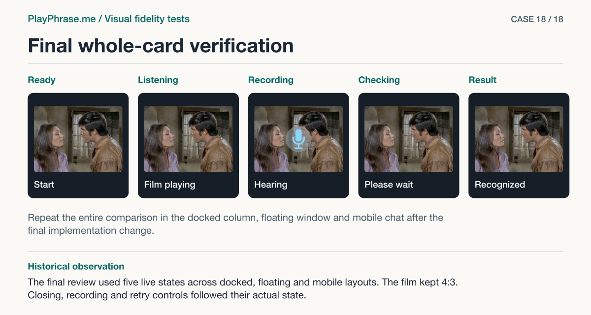

# 18 · Final whole-card verification

**Historical outcome · Final comparison.** The final review used five live states across docked, floating and mobile layouts. The film kept 4:3. Closing, recording and retry controls followed their actual state.



[See the English ImageGen redraw and review note](../imagegen/README.md#case-18)

## Attach these inputs in order

1. `inputs/verified-desktop-context.png`
2. `inputs/verified-all-mobile2.png`
3. `inputs/reference-07-transcript.png`
4. `inputs/reference-06-volume-meter.png`
5. `inputs/accepted-cycle-result-video.png`

The [input inventory](../INPUTS.md) identifies the original files. The figure above is a documentation diagram based on the historical review. Measurements belong to the original locale and viewport.

## English test prompt

```text
English edition. Render every user-interface label, caption, callout, diagnostic note and footer in English. Translate any localized interface copy in the reference images. Preserve actual spoken words, recognition errors, attempt values, units and measurement provenance. Treat source-locale geometry as historical evidence.

Independent visual examination of the entire supplied final HTML vs the same accepted original reference. Across the whole component, which material differences do you see, including any I have not named? Review EVERY supplied complete state and layout, not just the known scroll fix. Actual 1 desktop five states in docked and small floating 1440×900, followed by the actual clipped scroller view (header is visible at top and button reachable by scrolling). Actual 2 three rows of five complete mobile states, dark at 354×767, light at 390×844, long at 429×928. Each row ready/listening/recording/checking/result. The gray canvas outside each card is not app UI. Actual examples include score-only, partly graded and long confirmed errors without a numeric grade: do not fabricate grade or add red/green from reference. Input 3 = accepted 07 for full hierarchy, input 4 = accepted 06 for seven capsules/dot/title/close arrangement; input 5 = accepted historical states 01/02 and mobile sequence 04. New 4:3 media viewport supersedes previous drawings. Comparison of the input frames is authoritative; don’t use your own redrawing as evidence. Recheck header/scale/close, media/mic/controls/framing, phrase and synchronized partial/final line, score+hints, retry and parent viewport edges. In partial results use real neutral/green categories. Note intentional content/ratio/state variants. Return a English four-region annotated review sheet of the WHOLE card upper left “Current implementation” upper right “Accepted reference”, both same complete docked result, SAME utterance “You are not going.” with actual green/neutral and actual final “O K YOU ARE NOT GOING” / 98%. Full result card including original, recognized, score, hint, blue Repeat. Also a SMALL separate scroller callout for the short window, not replacing full cards. Inspect the other states in both contact sheets and summarize in an independent concise key including any unlisted material discrepancy. Lower “Keep” with exact “4:3 video. Show the seven bars only during recording. The title, result and available actions belong to the current card.” Lower “Change” exact “In the short window the header and conversation top edges both land at 197 CSS px. Repeat remains reachable by normal scrolling. The label measures 93 × 16 CSS px against a reference of about 96 × 18.” Add evidence-based residuals if present. Graphical drafting: magenta vertical double-ended line between PHOTO TOP and PHOTO BOTTOM only on EACH upper card with short extension ticks, label “249 CSS px · 4:3 video”. Blue brackets for heading, photo, phrase/ASR, score/hint and action; alignment guides along left real content edges. No fabricated dimensions and no numeric verdict matching the illustration. Footer “ImageGen mockup. Both cards are redrawn.”
```

[All examples](../README.md#prompt-index)
